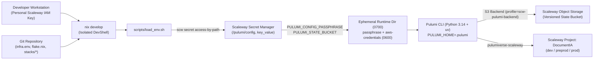
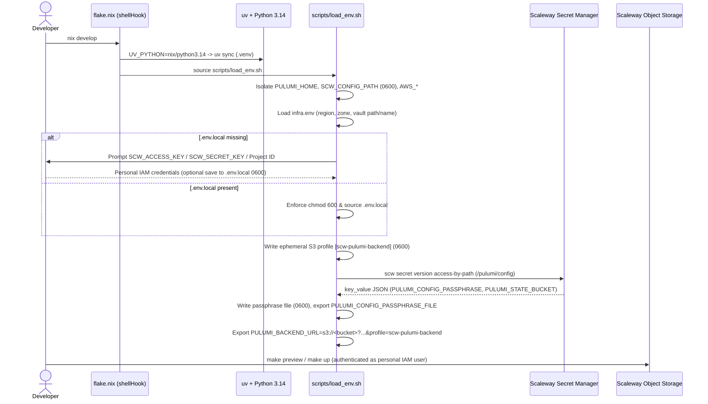
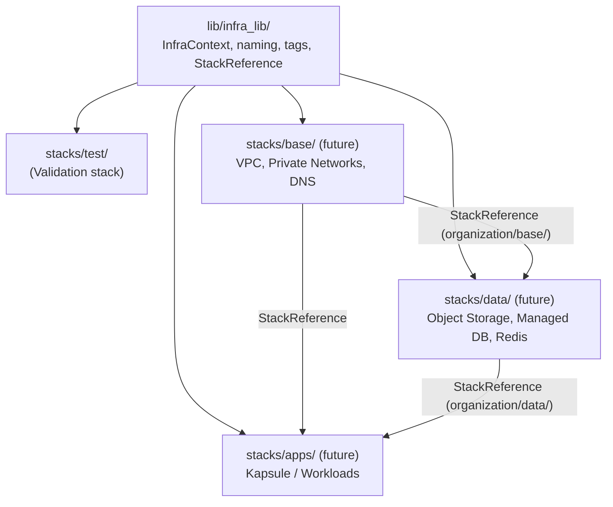

# Document IA Infrastructure — Technical Architecture & Design Decisions

This document describes the technical architecture of **`document-ia-infra`**, the rationale behind each structural choice, and how Nix, Pulumi (Python 3.14 + `uv`), and Scaleway work together.

---

## 1. System Overview

All **Document IA** cloud resources live inside a single Scaleway Project (**`DocumentIA`**) within the **DINUM** Organization. Environments (`dev`, `preprod`, `prod`) are isolated at the **Pulumi stack** and **resource naming/tagging** levels rather than across separate Scaleway projects.



### Core Design Goals

1. **Zero-friction onboarding**: Cloning the repository and running `nix develop` provisions every tool, Python dependency, secret, and backend configuration automatically.
2. **Strict host isolation**: Entering the Nix shell never reads from or writes to `~/.pulumi`, `~/.config/scw`, or `~/.aws`.
3. **Zero sensitive or internal identifiers in Git**: No credentials, no DINUM project UUID, and no state bucket name are committed.
4. **Per-developer auditability**: Every Secret Manager read, S3 state write, and Scaleway API mutation is authenticated under the developer's personal IAM identity for Scaleway Audit Trail / Cockpit (Grafana) visibility.
5. **Single environment-agnostic shell**: `nix develop` loads one shared tooling context; Pulumi stacks (`dev`, `preprod`, `prod`) manage environment-specific state and configuration.

---

## 2. Shell Bootstrap Sequence (`nix develop`)



---

## 3. Architecture Decision Records (ADRs)

### ADR-001: Pulumi Python 3.14 with `uv` Shared Virtualenv

* **Decision**: Use **Pulumi Python** on **Python 3.14**, managed by **`uv`** with a single root `.venv`, strict **Pyright** typechecking, and **Ruff** linting.
* **Rationale**:
  * Directly aligned with the main application repository (`document-ia`, which already uses Nix + Python 3.14 + `uv`).
  * Pulumi natively supports `toolchain: uv` in `Pulumi.yaml` with a shared relative `virtualenv: ../../.venv`, avoiding the slower `virtualenv` + `pipx` + `poetry` chain and eliminating per-stack venv duplication.
  * Setting `UV_PYTHON` to the Nix store's `python314` binary with `UV_PYTHON_DOWNLOADS=never` guarantees bit-for-bit runtime consistency across macOS (`aarch64-darwin`) and Linux (`x86_64-linux`, `aarch64-linux`).
* **Alternatives rejected**:
  * *TypeScript Pulumi*: Would introduce a second primary language stack for a Python-first team.
  * *Poetry*: Slower cold boot in Nix `shellHook` and redundant now that `uv` is natively supported by Pulumi.

### ADR-002: Single Environment-Agnostic Nix Shell

* **Decision**: `nix develop` takes no `ENV=` parameter and always builds a single unified shell. Environment selection (`dev`, `preprod`, `prod`) is handled exclusively by Pulumi stacks (`--stack <env>` / `make up stack=<name> env=<env>`).
* **Rationale**:
  * Eliminates the need to restart Nix or switch secret profiles when comparing or deploying across `dev`, `preprod`, and `prod`.
  * Stack-specific secrets are either encrypted in `Pulumi.<env>.yaml` (using the shared `PULUMI_CONFIG_PASSPHRASE` fetched from Scaleway Secret Manager) or fetched dynamically at deployment time via the Scaleway Pulumi provider (`pulumiverse-scaleway`).
* **Alternatives rejected**:
  * *Novops with per-environment shells (`NOVOPS_ENVIRONMENT=dev|prod`)*: Novops does not natively support Scaleway Secret Manager, and coupling the Nix shell lifecycle to a single environment adds unnecessary friction when Pulumi already provides multi-stack isolation.

### ADR-003: Scaleway Object Storage (S3) as Self-Hosted Pulumi Backend

* **Decision**: Store Pulumi state in a versioned **Scaleway Object Storage** bucket (`fr-par`) via the `s3://` backend URL:
  ```text
  s3://<bucket>?endpoint=s3.fr-par.scw.cloud&region=fr-par&s3ForcePathStyle=true&profile=scw-pulumi-backend
  ```
* **Rationale**:
  * Keeps all infrastructure state inside the sovereign DINUM Scaleway perimeter (no external SaaS dependency on Pulumi Cloud).
  * Bucket versioning (enabled by `scripts/bootstrap.sh`) protects against accidental state corruption.
  * **Dedicated ephemeral AWS profile (`scw-pulumi-backend`)**: Avoids exporting global `AWS_ACCESS_KEY_ID` / `AWS_SECRET_ACCESS_KEY`, preventing credential collisions if any future Pulumi stack targets AWS or Outscale alongside Scaleway.
  * **AWS SDK Go v2 checksum compatibility**: Recent Pulumi releases default to trailing payload checksums rejected by Scaleway S3 (`InvalidDigest`). Both `AWS_REQUEST_CHECKSUM_CALCULATION=when_required` and `AWS_RESPONSE_CHECKSUM_VALIDATION=when_required` are enforced via environment variables and the ephemeral `aws-config` profile.

### ADR-004: Scaleway Secret Manager (`key_value`) as Infrastructure Vault

* **Decision**: Store shared infrastructure bootstrap secrets (`PULUMI_CONFIG_PASSPHRASE`, `PULUMI_STATE_BUCKET`, and any future common tooling secrets) in **Scaleway Secret Manager** at `/pulumi/config` (`type=key_value`, `protected=true`).
* **Rationale**:
  * Zero dependency on external secret vaults (such as Vaultwarden/Bitwarden CLI or Node.js `@bitwarden/cli`).
  * Eliminates shared static decryption keys (such as a shared SOPS `age.key` file passed out-of-band).
  * Native IAM access control, versioning, and Scaleway Audit Trail integration.
  * Pulumi does not natively support Scaleway KMS as a `--secrets-provider`; storing a 256-bit `PULUMI_CONFIG_PASSPHRASE` in Scaleway Secret Manager and materializing it as `PULUMI_CONFIG_PASSPHRASE_FILE` (`chmod 600` outside the repo) is the cleanest native pattern.

### ADR-005: Personal Scaleway IAM API Key per Developer (No Shared Key, No Dynamic Key Generation)

* **Decision**: Each developer authenticates both Secret Manager and the Pulumi S3 state backend with their **personal Scaleway IAM API key** (configured with **Preferred Project for Object Storage = `DocumentIA`**).
* **Rationale**:
  * Scaleway uses the same IAM API key pair (`SCW_ACCESS_KEY` / `SCW_SECRET_KEY`) for Scaleway APIs and S3 Object Storage.
  * Every action is logged under the individual developer's `principal_id` in **Scaleway Audit Trail / Cockpit (Grafana)** — impossible with a shared vault S3 key.
  * Instant individual revocation during offboarding without rotating shared infrastructure credentials.
  * **Why dynamic key generation in Nix was rejected**: Creating API keys via `scw iam api-key create` would require granting high-privilege `IAMManager` permissions to every developer and would leak orphan keys on every shell start.
  * **Future CI/CD**: Automated pipelines will authenticate through a dedicated Scaleway **IAM Application** (e.g., `document-ia-ci`) so human and automated actions remain clearly distinguishable in audit logs.

### ADR-006: Multi-Stack Layout & Shared Typed Library (`lib/infra_lib`)

* **Decision**: Organize infrastructure into independent Pulumi projects under `stacks/<name>/` sharing a common editable Python package `lib/infra_lib/`.
* **Rationale**:
  * **Reduced blast radius**: Separating foundational networking/storage stacks from application stacks speeds up previews and limits failure domains.
  * **Consistent naming & tagging in a single Scaleway project**: `InfraContext.resource_name(component)` (`docia-<env>-<component>`) and `InfraContext.default_tags()` prevent resource name collisions across `dev`, `preprod`, and `prod` inside the shared `DocumentIA` project.
  * **Typed cross-stack contracts**: Each stack exports a structured `stack_data` `TypedDict` (via `outputs.py`) consumed by downstream stacks through `infra_lib.get_stack_data(project_name, env)` (which uses `organization/<project_name>/<env>` as required by self-managed S3 backends).



---

## 4. Repository Layout

```text
document-ia-infra/
├── flake.nix                  # Reproducible Nix DevShell (Python 3.14, uv, Pulumi, scw, awscli2)
├── flake.lock                 # Pinned nixpkgs revision
├── infra.env                  # Generic non-sensitive config (region, zone, vault path/name)
├── .env.local.example         # Template for developer-local Scaleway credentials
├── .envrc.example             # Optional direnv integration (`use flake`)
├── pyproject.toml             # uv project & dev tooling config (Ruff, Pyright, Hatchling)
├── uv.lock                    # Locked Python dependency graph
├── pyrightconfig.json         # Strict Pyright configuration shared with Pulumi
├── Makefile                   # Standard operational targets (bootstrap, preview, up, destroy, check)
├── docs/
│   ├── ARCHITECTURE.md        # This document (ADRs & system design)
│   └── SECURITY_AND_SECRETS.md# Security model, isolation matrix & IAM guidelines
├── scripts/
│   ├── load_env.sh            # Sourced by flake.nix: isolation, vault loader, S3 profile setup
│   └── bootstrap.sh           # Idempotent one-time initialization (state bucket + vault secret)
├── lib/infra_lib/
│   ├── config.py              # InfraContext, resource_name(), default_tags()
│   └── stack_output.py        # Typed StackReference helpers for S3 self-managed backend
└── stacks/
    └── test/                  # Initial validation stack (zero-cost by default)
```
