# Document IA Infrastructure — Technical Architecture & Design Decisions

This document describes the technical architecture of **`document-ia-infra`**, the rationale behind each structural choice, how Nix, Pulumi (Python 3.14 + `uv`), and Scaleway work together, the target cloud architecture for hosting **Document IA** on Scaleway, and the stack-by-stack decomposition with typed inter-stack dependency contracts.

---

## 1. System Overview

All **Document IA** cloud resources live inside a single Scaleway Project (**`DocumentIA`**) within the **DINUM** Organization. Environments (`dev`, `staging`, `sandbox`, `preprod`, `prod`) are isolated at the **Pulumi stack**, **Private Network**, and **resource naming/tagging** levels rather than across separate Scaleway projects.

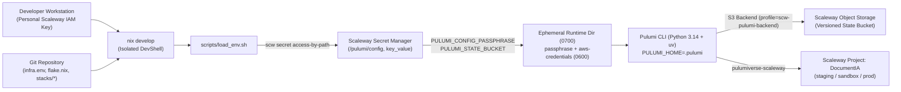

### Core Design Goals

1. **Zero-friction onboarding**: Cloning the repository and running `nix develop` provisions every tool, Python dependency, secret, and backend configuration automatically.
2. **Strict host isolation**: Entering the Nix shell never reads from or writes to `~/.pulumi`, `~/.config/scw`, or `~/.aws`.
3. **Zero sensitive or internal identifiers in Git**: No credentials, no DINUM project UUID, and no state bucket name are committed.
4. **Per-developer auditability**: Every Secret Manager read, S3 state write, and Scaleway API mutation is authenticated under the developer's personal IAM identity for Scaleway Audit Trail / Cockpit (Grafana) visibility.
5. **Single environment-agnostic shell**: `nix develop` loads one shared tooling context; Pulumi stacks manage environment-specific state and configuration.
6. **Strict private-network isolation**: Only frontal HTTPS entry points (the cluster Load Balancer for API/Evals and the managed Serverless Container endpoint for Metabase) are publicly reachable; all compute nodes, PostgreSQL databases (both Main and Shared Analytics), and Redis clusters run exclusively inside private networks without public IP addresses.

---

## 2. Shell Bootstrap Sequence (`nix develop`)

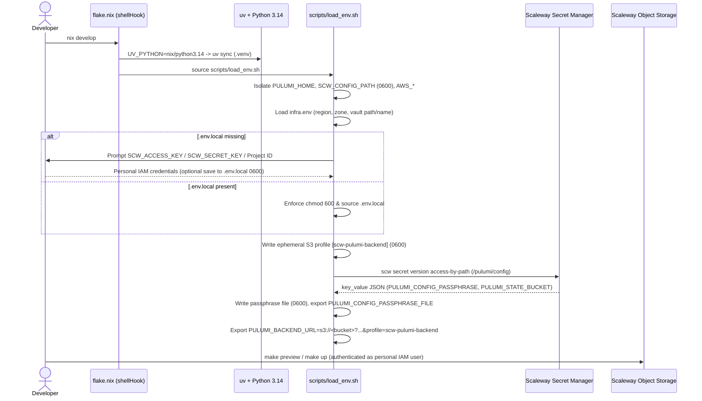

---

## 3. Architecture Decision Records (ADRs)

### ADR-001: Pulumi Python 3.14 with `uv` Shared Virtualenv

* **Decision**: Use **Pulumi Python** on **Python 3.14**, managed by **`uv`** with a single root `.venv`, strict **Pyright** typechecking, and **Ruff** linting.
* **Rationale**:
  * Directly aligned with the main application repository (`document-ia`, which already uses Nix + Python 3.14 + `uv`).
  * Pulumi natively supports `toolchain: uv` in `Pulumi.yaml` with a shared relative `virtualenv: ../../.venv`, avoiding the slower `virtualenv` + `pipx` + `poetry` chain and eliminating per-stack venv duplication.
  * Setting `UV_PYTHON` to the Nix store's `python314` binary with `UV_PYTHON_DOWNLOADS=never` guarantees bit-for-bit runtime consistency across macOS (`aarch64-darwin`) and Linux (`x86_64-linux`, `aarch64-linux`).
* **Alternatives rejected**:
  * *TypeScript Pulumi*: Would introduce a second primary language stack for a Python-first team.
  * *Poetry*: Slower cold boot in Nix `shellHook` and redundant now that `uv` is natively supported by Pulumi.

### ADR-002: Single Environment-Agnostic Nix Shell

* **Decision**: `nix develop` takes no `ENV=` parameter and always builds a single unified shell. Environment selection (`dev`, `staging`, `sandbox`, `preprod`, `prod`) is handled exclusively by Pulumi stacks (`--stack <env>` / `make up stack=<name> env=<env>`).
* **Rationale**:
  * Eliminates the need to restart Nix or switch secret profiles when comparing or deploying across environments.
  * Stack-specific secrets are either encrypted in `Pulumi.<env>.yaml` (using the shared `PULUMI_CONFIG_PASSPHRASE` fetched from Scaleway Secret Manager) or fetched dynamically at deployment time via the Scaleway Pulumi provider (`pulumiverse-scaleway`).
* **Alternatives rejected**:
  * *Novops with per-environment shells (`NOVOPS_ENVIRONMENT=dev|prod`)*: Novops does not natively support Scaleway Secret Manager, and coupling the Nix shell lifecycle to a single environment adds unnecessary friction when Pulumi already provides multi-stack isolation.

### ADR-003: Scaleway Object Storage (S3) as Self-Hosted Pulumi Backend

* **Decision**: Store Pulumi state in a versioned **Scaleway Object Storage** bucket (`fr-par`) via the `s3://` backend URL:
  ```text
  s3://<bucket>?endpoint=s3.fr-par.scw.cloud&region=fr-par&s3ForcePathStyle=true&profile=scw-pulumi-backend
  ```
* **Rationale**:
  * Keeps all infrastructure state inside the sovereign DINUM Scaleway perimeter (no external SaaS dependency on Pulumi Cloud).
  * Bucket versioning (enabled by `scripts/bootstrap.sh`) protects against accidental state corruption.
  * **Dedicated ephemeral AWS profile (`scw-pulumi-backend`)**: Avoids exporting global `AWS_ACCESS_KEY_ID` / `AWS_SECRET_ACCESS_KEY`, preventing credential collisions if any future Pulumi stack targets AWS or Outscale alongside Scaleway.
  * **AWS SDK Go v2 checksum compatibility**: Recent Pulumi releases default to trailing payload checksums rejected by Scaleway S3 (`InvalidDigest`). Both `AWS_REQUEST_CHECKSUM_CALCULATION=when_required` and `AWS_RESPONSE_CHECKSUM_VALIDATION=when_required` are enforced via environment variables and the ephemeral `aws-config` profile.

### ADR-004: Scaleway Secret Manager (`key_value`) as Infrastructure Vault

* **Decision**: Store shared infrastructure bootstrap secrets (`PULUMI_CONFIG_PASSPHRASE`, `PULUMI_STATE_BUCKET`, and any future common tooling secrets) in **Scaleway Secret Manager** at `/pulumi/config` (`type=key_value`, `protected=true`).
* **Rationale**:
  * Zero dependency on external secret vaults (such as Vaultwarden/Bitwarden CLI or Node.js `@bitwarden/cli`).
  * Eliminates shared static decryption keys (such as a shared SOPS `age.key` file passed out-of-band).
  * Native IAM access control, versioning, and Scaleway Audit Trail integration.
  * Pulumi does not natively support Scaleway KMS as a `--secrets-provider`; storing a 256-bit `PULUMI_CONFIG_PASSPHRASE` in Scaleway Secret Manager and materializing it as `PULUMI_CONFIG_PASSPHRASE_FILE` (`chmod 600` outside the repo) is the cleanest native pattern.

### ADR-005: Personal Scaleway IAM API Key per Developer (No Shared Key, No Dynamic Key Generation)

* **Decision**: Each developer authenticates both Secret Manager and the Pulumi S3 state backend with their **personal Scaleway IAM API key** (configured with **Preferred Project for Object Storage = `DocumentIA`**).
* **Rationale**:
  * Scaleway uses the same IAM API key pair (`SCW_ACCESS_KEY` / `SCW_SECRET_KEY`) for Scaleway APIs and S3 Object Storage.
  * Every action is logged under the individual developer's `principal_id` in **Scaleway Audit Trail / Cockpit (Grafana)** — impossible with a shared vault S3 key.
  * Instant individual revocation during offboarding without rotating shared infrastructure credentials.
  * **Why dynamic key generation in Nix was rejected**: Creating API keys via `scw iam api-key create` would require granting high-privilege `IAMManager` permissions to every developer and would leak orphan keys on every shell start.
  * **Future CI/CD**: Automated pipelines will authenticate through a dedicated Scaleway **IAM Application** (e.g., `document-ia-ci`) so human and automated actions remain clearly distinguishable in audit logs.

### ADR-006: Multi-Stack Layout & Shared Typed Library (`lib/infra_lib`)

* **Decision**: Organize infrastructure into **7 layered, independent Pulumi projects** under `stacks/<name>/` sharing a common editable Python package `lib/infra_lib/`:
  * **Layer 0 — `stacks/base` (`env=shared`)**: Project-wide shared foundation unique to Scaleway project `DocumentIA`: **Shared Regional VPC** (`enable_routing=True`) with **VPC Network ACL** (`default_policy="drop"` allowing only `pn-<env> -> pn-analytics:5432` + return traffic), Scaleway Cockpit activation, and shared private Container Registry (+ CI push IAM App).
  * **Layer 1A — `stacks/network` (per network boundary)**: Isolated `PrivateNetwork` (dedicated non-overlapping CIDR inside the shared VPC), Public Gateway (NAT + static egress IP + SSH Bastion), Reserved Ingress Load Balancer IP, and scoped Cockpit logging token.
  * **Layer 1B — `stacks/analytics` (`env=shared`)**: Dedicated `pn-analytics` Private Network inside the shared VPC, **100 % private** Shared Analytics PostgreSQL RDB (zero public IP), schema-scoped roles/grants via `pulumi-postgresql`, and **Metabase** hosted as a **Scaleway Serverless Container** (`min_scale=1`, attached to `pn-analytics`) with managed TLS custom domain.
  * **Layer 1C — `stacks/observability` (`env=shared`)**: Declarative observability-as-code on Scaleway Cockpit — versioned Grafana dashboards provisioned via `pulumiverse-grafana` (IAM `X-Auth-Token`), `scaleway.observability.AlertManager` (preconfigured infra alerts + contact points), and versioned custom Loki/Mimir alerting rules.
  * **Layer 2 — `stacks/data` (always per environment: `staging`, `sandbox`, `prod`)**: Dedicated S3 Documents bucket (7-day lifecycle + scoped IAM App + S3 Bucket Policy), Main PostgreSQL RDB (private only), Managed Redis 7+ (`noeviction`, private only), and environment Secret Manager bundle.
  * **Layer 3 — `stacks/cluster` (per Kubernetes cluster)**: Scaleway Kapsule cluster (`cni="cilium"`), private Node Pools (`api-system`, `workers`), **Traefik** bound to the reserved LB IP via Scaleway CCM (TCP L4 + Proxy Protocol v2), **`cert-manager`** (Let's Encrypt HTTP-01), KEDA Operator, and Kubernetes Namespaces.
  * **Layer 4 — `stacks/apps` (always per environment: `staging`, `sandbox`, `prod`)**: Application Kubernetes workloads (`document-ia-api`, `document-ia-worker`, `document-ia-evals` exposed on `console.*`, 2 `CronJob`s, KEDA `ScaledObject`, Cilium `NetworkPolicy`, `Ingress` with automated TLS, and `v1.Secret` materialized by Pulumi from Secret Manager).
* **Rationale**:
  * **Strict lifecycle separation**: Decoupling slow-changing cluster infrastructure (`stacks/cluster`) from fast-moving application releases (`stacks/apps`) and separating dashboards/alerts (`stacks/observability`) from critical networking (`stacks/base`) keeps blast radius minimal—tweaking a Grafana panel or alert threshold never touches the shared VPC or ACLs.
  * **Zero public IP on any database & clean DAG**: Putting the shared VPC + default-deny VPC Network ACL in `stacks/base` allows `stacks/network` (Layer 1A) and `stacks/analytics` (Layer 1B) to deploy independently in parallel, keeps 100 % of analytics replication traffic inside private RFC 1918 networks, and decouples Metabase completely from Kubernetes clusters.
  * **No Scaleway project-level resource conflicts**: Scaleway Cockpit is unique per Scaleway project and OCI images (~1.5 GiB worker images) should be built once and promoted by immutable digest across environments; placing them in `stacks/base` (`env=shared`) prevents state collisions and image duplication.
  * **Topology flexibility without code duplication**: Separating `network` and `cluster` from `data` and `apps` enables both a **fully symmetric topology** (1 cluster per environment) and a **2-cluster topology** (`non-prod` shared by `staging` + `sandbox`, `prod` dedicated) using the exact same `stacks/data` and `stacks/apps` code (see [ADR-012](#adr-012-environment-isolation-topologies-symmetric-vs-2-cluster-non-prod--prod)).
  * **Consistent naming & tagging in a single Scaleway project**: `InfraContext.resource_name(component)` (`docia-<env>-<component>`) and `InfraContext.default_tags()` prevent resource name collisions across environments inside the shared `DocumentIA` project.
  * **Typed cross-stack contracts**: Each stack exports a structured `stack_data` `TypedDict` (via `outputs.py`) consumed by downstream stacks through `infra_lib.get_stack_data(project_name, env)` (which uses `organization/<project_name>/<env>` as required by self-managed S3 backends).

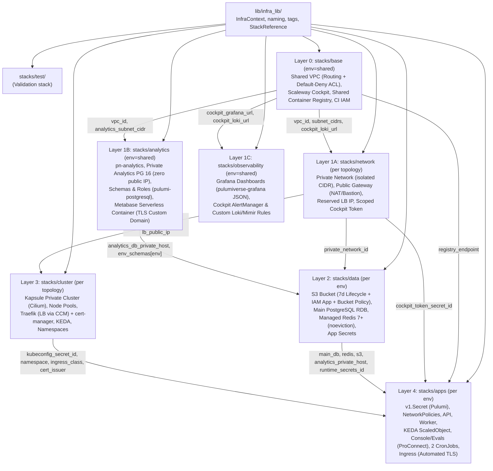

### ADR-007: Scaleway Kubernetes Kapsule with Private Node Pools, Separated Cluster/App Stacks & Traefik + `cert-manager` Ingress

* **Decision**: Run all Document IA application workloads (`api`, `worker`, `evals`, `CronJob`s) on **Scaleway Kubernetes Kapsule** using **100% private Node Pools** (`public_ip_disabled=True`) attached to their environment's `PrivateNetwork`, fronted by a **single Scaleway Load Balancer** per cluster in **TCP L4 (Proxy Protocol v2)** mode feeding **Traefik** + **`cert-manager`**, split across `stacks/cluster` (cluster + operators) and `stacks/apps` (workloads).
* **Rationale**:
  * **Strict network perimeter**: Compute nodes have zero public IPv4/IPv6 addresses and cannot be reached directly from the Internet.
  * **Single HTTPS entry point (no duplicate LB, future-proof Ingress)**: `stacks/network` reserves a static `scaleway.loadbalancers.Ip`. In `stacks/cluster`, **Traefik** (replacing upstream `ingress-nginx`, which reached EOL in early 2026, and natively supporting both `Ingress` and Kubernetes Gateway API) is installed with Scaleway CCM annotations binding its `LoadBalancer` Service directly to that reserved IP over the `PrivateNetwork` with Proxy Protocol v2 enabled (`scw-loadbalancer-proxy-protocol-v2: "true"`). **`cert-manager`** terminates TLS 1.3 with automated Let's Encrypt HTTP-01 certificates for Host-based routing:
    * `api.<env>.*` (prod: `api.*`) $\rightarrow$ `document-ia-api` (FastAPI REST API).
    * `console.<env>.*` (prod: `console.*`) $\rightarrow$ `document-ia-evals` (Streamlit evaluation console, authenticated via **ProConnect** OIDC).
  * **Native Kubernetes CronJobs & NetworkPolicies**: Replaces custom PaaS schedulers with native Kubernetes `CronJob` resources (`remove-ppi`, `replicate-analytics`) and **Cilium `NetworkPolicy`** rules providing defense-in-depth against SSRF lateral movement and cross-environment isolation.
  * **Kubernetes Secrets managed in `stacks/apps`**: For simplicity in the initial architecture, `stacks/apps` reads the environment secret bundle from Scaleway Secret Manager and materializes the Kubernetes `v1.Secret` directly via Pulumi (encrypted in the Pulumi S3 state). *(Migrating to External Secrets Operator remains a non-breaking future evolution if automated secret rotation without `pulumi up` is needed later).*
* **Alternatives rejected**:
  * *Scaleway Serverless Containers for API/Worker*: Cold-start and RAM/disk constraints with the ~418 MiB pre-bundled AI/OCR models (`yolov8m-world.pt`, `ViT-B-32.pt`, `qrdet-s.pt`, `fra.traineddata`) and Redis Streams KEDA worker pooling. *(Note: Serverless Containers ARE an ideal fit for the stateless Metabase BI container—see [ADR-009](#adr-009-shared-private-analytics-postgresql--metabase-serverless-container-stacksanalytics)).*
  * *Raw Scaleway Instances (VMs)*: Requires custom tooling for rolling deployments, health probing, cron orchestration, and node auto-scaling.

### ADR-008: Scaleway Public Gateway (NAT Egress & SSH Bastion) for Private Compute Nodes

* **Decision**: Attach a **Scaleway Public Gateway** (`scaleway.vpcgw.Gateway` + `GatewayNetwork` with `enable_masquerade=True`, SSH Bastion support, and a reserved static `vpcgw.Ip`) to each compute `PrivateNetwork` in `stacks/network`.
* **Rationale**:
  * On Scaleway, **Managed PostgreSQL (RDB)** (both per-env Main DB and Shared Analytics DB via VPC Routing) and **Managed Redis** attach directly to `PrivateNetwork`s with private RFC 1918 IPs (`172.16.x.x`) and are accessed directly over L2/L3 without traversing any Public Gateway.
  * Conversely, **regional Scaleway services**—including **Scaleway Object Storage (`s3.fr-par.scw.cloud`)**, **Scaleway Container Registry (`rg.fr-par.scw.cloud`)**, **Scaleway Cockpit (`logs.cockpit.fr-par.scw.cloud`)**, and **Scaleway Secret Manager**—do not provide private VPC Endpoint IPs; their DNS names resolve to Scaleway public IPs.
  * Because Kapsule nodes have `public_ip_disabled=True`, any outbound packet addressed outside the VPC CIDR requires an L3 NAT default gateway (**Scaleway Public Gateway**):
    1. **Intra-Scaleway regional traffic** (S3 document uploads/downloads, container image pulls, Loki log pushes) is NATed by the Public Gateway while remaining physically on the internal Scaleway `fr-par` backbone.
    2. **External Internet egress** is routed through the static Public Gateway IP to reach **Albert API** (`https://albert.api.etalab.gouv.fr/v1`) for OCR/LLM calls, external document download URLs (`file_url` protected by `SafeAsyncHTTPTransport` anti-SSRF socket pinning), customer **Webhook** endpoints, and **ProConnect** OIDC endpoints.
    3. Having a **static egress IP** allows partner webhook receivers and Albert API to whitelist Document IA's outbound traffic deterministically, while the built-in **SSH Bastion** enables authenticated operator/CI tunneling to private VPC databases (such as running `pulumi-postgresql` against the private Analytics RDB) without exposing public DB endpoints.

### ADR-009: Shared Private Analytics PostgreSQL & Metabase Serverless Container (`stacks/analytics`)

* **Decision**:
  1. **100 % Private Multi-Environment Connectivity (Option R1)**: Place all `PrivateNetwork`s inside a **single shared Regional VPC** (`docia-shared-vpc`, declared in `stacks/base` with Scaleway **VPC Routing** enabled) protected by a **default-deny VPC Network ACL** (`scaleway.network.Acl`, `default_policy="drop"`). Provision a dedicated `pn-analytics` (`172.16.0.0/24`) in `stacks/analytics` and attach the shared PostgreSQL Analytics RDB (`docia-shared-pg-analytics`) **exclusively to `pn-analytics`** (zero public IP / empty public ACL).
  2. **Schema-Level RBAC via `pulumi-postgresql`**: Use the **`pulumi-postgresql`** provider to declaratively manage per-environment schemas (`staging`, `sandbox`, `prod`) and least-privilege schema grants (`metabase` RW `public` + RO env schemas; `docia_<env>_analytics` RW strictly on its own `<env>` schema).
  3. **Decoupled Metabase Hosting on Scaleway Serverless Containers (Option M1)**: Deploy **Metabase** directly inside `stacks/analytics` as a **Scaleway Serverless Container** (`min_scale=1`, `max_scale=1`, 2–4 GiB RAM) attached to `pn-analytics`, with a managed TLS Let's Encrypt custom domain (`metabase.document-ia.beta.gouv.fr`).
* **Rationale**:
  * **Zero public database exposure**: Every database in Document IA (all per-env Main RDBs AND the Shared Analytics RDB) is 100 % private on RFC 1918 IPs. Scaleway's VPC vRouter routes `pn-<env>` $\rightarrow$ `pn-analytics:5432` privately while the stateless VPC Network ACL (`default_policy="drop"`) guarantees that **zero cross-environment traffic** is ever allowed between `pn-staging`, `pn-sandbox`, and `pn-prod`.
  * **Stateless VPC Network ACL rules**: Because Scaleway VPC ACLs are stateless, `stacks/base` explicitly pairs each inbound rule (`pn-<env> -> pn-analytics:5432`) with its matching return rule (`pn-analytics:5432 -> pn-<env>:1024-65535`).
  * **Complete decoupling of Metabase from Kapsule**: Metabase is 100 % stateless (all dashboards, users, and metadata live in PostgreSQL schema `public`). Running it as an always-on Serverless Container (`min_scale=1` to eliminate JVM cold starts) avoids coupling internal BI availability or attack surface to the `prod` (or `non-prod`) Kubernetes cluster, avoids any extra Load Balancer or cluster cost, and keeps the entire Analytics + BI stack self-contained in `stacks/analytics` with zero circular dependencies.
  * **Schema-level RBAC via `pulumi-postgresql`**: Scaleway's native `scaleway.databases.Privilege` only grants database-level rights. Using `pulumi-postgresql` (`postgresql.Schema`, `postgresql.Role`, `postgresql.Grant`, `postgresql.DefaultPrivileges`) enforces strict per-schema isolation.
  * *Operational note (`pulumi-postgresql` on a 100 % private DB)*: Because `docia-shared-pg-analytics` has no public endpoint, applying schema/role changes in `stacks/analytics` connects via an **SSH tunnel through a Scaleway Public Gateway Bastion** (which already belongs to a `pn-<env>` permitted by the VPC ACL to reach `pn-analytics:5432`) or via a private VPC CI runner.

### ADR-010: Event-Driven Worker Auto-Scaling with KEDA on Redis Streams (`lagCount` + HPA Cooldowns)

* **Decision**: Use **KEDA (Kubernetes Event-driven Autoscaling)** (`redis-streams` trigger on `lagCount`) paired with **Kubernetes HPA `behavior` policies** and the **Kapsule Cluster Autoscaler** to dynamically scale `document-ia-worker` pods and underlying worker VM nodes while strictly replicating the hysteresis and cooldown behavior of the legacy `document-ia-auto-scaler`.
* **Rationale**:
  * Replaces the legacy `document-ia-auto-scaler` daemon (which was built around the Scalingo REST API because Scalingo lacked Redis queue-based auto-scaling) with a native Kubernetes controller requiring zero custom daemon code.
  * **Exact metric parity**: Uses KEDA's `lagCount` parameter (`XINFO GROUPS` consumer group lag = `nb_execution_undelivered`, excluding already in-flight PEL entries), matching the exact signal previously read from `/api/v1/health`.
  * **Anti-flapping cooldowns (`minReplicaCount >= 1`)**: Because KEDA's `spec.cooldownPeriod` only governs `1 -> 0` scale-to-zero transitions, anti-oscillation between `N -> minReplicaCount` is enforced via Kubernetes HPA `behavior` rules (`scaleUp`: max `+1 Pod / 120s` with `30s` stabilization; `scaleDown`: `300s` stabilization window + max `-1 Pod / 300s`).
  * **Graceful drain on scale-down**: `document-ia-worker` sets `terminationGracePeriodSeconds: 180` (vs. Kubernetes' 30s default) so in-flight OCR/Albert threads finish cleanly and `XACK` before pod termination.
  * KEDA's operator is provisioned in `stacks/cluster`, while each environment's `ScaledObject` lives alongside `document-ia-worker` in `stacks/apps` (see [Section 4.6](#46-event-driven-worker-auto-scaling-keda--hpa--kapsule-cluster-autoscaler)).

### ADR-011: Shared Private Scaleway Container Registry, Project-Level Cockpit & Observability-as-Code (`stacks/base` + `stacks/observability`)

* **Decision**:
  1. Provision a **single shared private Scaleway Container Registry** (`rg.fr-par.scw.cloud`) in `stacks/base` (`env=shared`), paired with a dedicated CI push IAM Application, so `document-ia` builds immutable multi-stage Nix `FROM scratch` images once and promotes them across `staging`, `sandbox`, and `prod`.
  2. Activate **Scaleway Cockpit** (managed Loki + Prometheus/Mimir + Grafana) once in `stacks/base` (`env=shared`), while creating per-boundary scoped `observability.Token` (`write_logs=True`) credentials in `stacks/network`.
  3. Manage **Grafana dashboards and alerting declaratively as code** in a dedicated stack **`stacks/observability` (`env=shared`)**:
     * **Dashboards**: Versioned JSON files (`stacks/observability/dashboards/*.json`) provisioned into a custom `Document IA` folder via **`pulumiverse-grafana`**, authenticating to Scaleway Cockpit's Grafana endpoint using Scaleway IAM (`auth="anonymous"` + `X-Auth-Token: <SCW_SECRET_KEY>` — no legacy Grafana user/password).
     * **Infrastructure Alerts**: Managed natively via **`scaleway.observability.AlertManager`** (`preconfigured_alert_ids` for Kapsule, PostgreSQL RDB, Redis, Load Balancer + notification `contact_points`).
     * **Custom Application Alerts (Loki/Mimir)**: Because Scaleway Cockpit evaluates alerting rules at the data-source level rather than via Grafana-managed Alertmanager, custom application alert rules (e.g., API 5xx spikes, Redis DLQ growth, queue lag) are versioned as YAML in `stacks/observability/alerts/` and pushed declaratively to Cockpit's standard Loki/Mimir Ruler APIs (`/loki/api/v1/rules`, `/prometheus/config/v1/rules`), routed through Cockpit's Alert Manager.
* **Rationale**:
  * Scaleway Cockpit is a **singleton per Scaleway Project** (`DocumentIA`); managing its activation in `stacks/base` prevents duplicate-resource conflicts across per-environment stacks.
  * Isolating dashboards and alert rules into **`stacks/observability`** guarantees zero blast radius on `stacks/base` (VPC, Network ACL, Registry) whenever dashboards or alert thresholds are updated, and makes the entire observability setup reproducible with a single `make up stack=observability env=shared`.
  * A shared Container Registry avoids triplicating ~1.5 GiB worker images (containing 418 MiB of SHA-256 verified AI/OCR weights) and keeps image pulls inside the local `fr-par` Scaleway backbone during worker scale-up events.
  * `document-ia-api` and `document-ia-worker` natively emit structured JSON logs and fixed-schema operational metrics (`redis_delivery`, `event_purge`) directly to Loki (`/loki/api/v1/push`) with Bearer authentication.

### ADR-012: Environment Isolation Topologies (Symmetric vs. 2-Cluster `non-prod` / `prod`)

* **Decision**: Design the stack contracts (`stacks/network`, `stacks/cluster`, `stacks/data`, `stacks/apps`) to natively support **two deployment topologies** inside the shared VPC without duplicating application or data stack code. Both topologies are documented side-by-side below until the final trade-off (cost/operations vs. strict cluster symmetry) is ratified:
  * **Topology A — Fully Symmetric (3 Clusters: `staging`, `sandbox`, `prod`)**: Every environment owns its dedicated Private Network (non-overlapping CIDR in the shared VPC), Public Gateway, Load Balancer, and Kapsule cluster (`stacks/network` and `stacks/cluster` instantiated 3 times).
  * **Topology B — Shared Non-Prod + Dedicated Prod (2 Clusters: `non-prod`, `prod`)**: `staging` and `sandbox` share a single `non-prod` Private Network, Public Gateway, Load Balancer, and Kapsule cluster, isolated by dedicated **Kubernetes Namespaces** (`docia-staging`, `docia-sandbox`) and strict **Cilium `NetworkPolicy`** rules; `prod` remains 100% physically isolated in its own `prod` Private Network and cluster.
* **Key Invariant Across Both Topologies**:
  * **100 % Private Analytics & Metabase**: Both topologies share the exact same `stacks/base` (VPC + default-deny VPC ACL) and `stacks/analytics` (`pn-analytics` + private Analytics RDB + Metabase Serverless Container).
  * **`stacks/data` is ALWAYS 100% isolated per environment** (`staging`, `sandbox`, `prod` each have their own dedicated Main PostgreSQL RDB, Managed Redis 7+, S3 Bucket with 7-day lifecycle, S3 Bucket Policy, and Secret Manager bundle).
  * **`stacks/apps` is ALWAYS deployed per environment** (`staging`, `sandbox`, `prod`), consuming `network_env` and `cluster_env` from Pulumi stack config (`network_env == env` in Topology A; `network_env == "non-prod"` for `staging`/`sandbox` in Topology B).

| Dimension | Topology A — Fully Symmetric (`staging` / `sandbox` / `prod`) | Topology B — 2 Clusters (`non-prod` + `prod`) |
|---|---|---|
| **Shared VPC & Analytics** | 1 VPC + Default-Deny VPC ACL + `pn-analytics` (`172.16.0.0/24`) + Metabase Serverless Container | *Identical* |
| **Private Networks (CIDRs)** | `pn-staging` (`172.16.4.0/22`), `pn-sandbox` (`172.16.8.0/22`), `pn-prod` (`172.16.12.0/22`) | `pn-non-prod` (`172.16.4.0/22`), `pn-prod` (`172.16.12.0/22`) |
| **Network & Compute Stacks** | 3x `stacks/network` + 3x `stacks/cluster` | 2x `stacks/network` (`non-prod`, `prod`) + 2x `stacks/cluster` (`non-prod`, `prod`) |
| **Data & App Stacks** | 3x `stacks/data` + 3x `stacks/apps` | 3x `stacks/data` + 3x `stacks/apps` *(identical)* |
| **Fixed Infra Overhead** | 3 Load Balancers, 3 Public Gateways, 3x `api-system` + `workers` Node Pools | 2 Load Balancers, 2 Public Gateways, 2x `api-system` + `workers` Node Pools (~30–35% lower baseline cost on non-prod) |
| **Cluster Upgrade & K8s Ops** | 3 Kapsule clusters to upgrade/monitor; `staging` mirrors `prod` 1:1 | 2 Kapsule clusters to upgrade/monitor; `non-prod` hosts both `docia-staging` and `docia-sandbox` namespaces |
| **Blast Radius (`staging` ↔ `sandbox`)** | Network L2/L3 (separate PNs blocked by VPC ACL) + separate K8s control planes & nodes | Logical (separate K8s Namespaces, Cilium `NetworkPolicy`, separate RDB/Redis/S3; shared K8s control plane, ingress LB & NAT IP) |
| **Prod Isolation** | 100% isolated (dedicated PN blocked by VPC ACL + dedicated cluster) | 100% isolated *(identical to Topology A)* |

### ADR-013: DNS Hosting on OVH & Fully Automated Let's Encrypt TLS

* **Decision**:
  1. **Keep the DNS zone on OVH** (no NS delegation to Scaleway DNS required at launch). Because Load Balancer IPv4 addresses are reserved statically in `stacks/network` (`lb_public_ip`) and Metabase exposes a stable Scaleway Serverless Container hostname (`metabase_cname_target`), only static DNS entries (`A` and `CNAME`) are maintained in OVH.
  2. **Public Hostname Convention**:
     * API: `api.<env>.<domain>` (prod: `api.<domain>`)
     * Evaluation Console (`document-ia-evals`): **`console.<env>.<domain>`** (prod: **`console.<domain>`**)
     * Metabase BI: `metabase.<domain>`
  3. **100 % Automated Let's Encrypt TLS (DNS-Provider Agnostic)**:
     * **Kapsule clusters (`api.*` & `console.*`)**: Scaleway LB forwards raw TCP `80`/`443` with Proxy Protocol v2 to **Traefik**, and **`cert-manager`** (`ClusterIssuer` using ACME **HTTP-01**) automatically issues and renews TLS certificates per Kubernetes `Ingress` without requiring any OVH DNS API credentials.
     * **Metabase Serverless Container (`metabase.*`)**: Scaleway manages Let's Encrypt issuance and renewal natively via `scaleway.containers.Domain` as soon as the OVH `CNAME` record resolves.
* **Rationale**:
  * **Zero-risk incremental migration from Scalingo**: Preserves all existing OVH records (MX, SPF/DKIM, active Scalingo routes) and allows switching one environment at a time (`staging` $\rightarrow$ `sandbox` $\rightarrow$ `prod`) with instant DNS rollback.
  * **Minimal static DNS footprint**: Only 7 records total across all environments (`A` records pointing to immutable reserved LB IPs + 1 `CNAME` for Metabase), never broken by cluster rebuilds.
  * *Operational check on OVH*: If the OVH zone defines `CAA` records, ensure `0 issue "letsencrypt.org"` is permitted so both `cert-manager` and Scaleway Serverless Containers can issue certificates.
  * *Future evolution*: Delegating a subdomain to Scaleway DNS (or automating OVH records via `pulumi-ovh`) remains a non-breaking option if dynamic preview environments or wildcard (`DNS-01`) certificates are ever needed.

#### OVH DNS Records Matrix

| Hostname | Record Type | Target (Topology A — 3 Clusters) | Target (Topology B — 2 Clusters) | TLS Issued Automatically By |
|---|---|---|---|---|
| `api.staging.<domain>` | `A` | `lb_public_ip` (`network/staging`) | `lb_public_ip` (`network/non-prod`) | `cert-manager` (HTTP-01) + Traefik |
| `console.staging.<domain>` | `A` | `lb_public_ip` (`network/staging`) | `lb_public_ip` (`network/non-prod`) | `cert-manager` (HTTP-01) + Traefik |
| `api.sandbox.<domain>` | `A` | `lb_public_ip` (`network/sandbox`) | `lb_public_ip` (`network/non-prod`) | `cert-manager` (HTTP-01) + Traefik |
| `console.sandbox.<domain>` | `A` | `lb_public_ip` (`network/sandbox`) | `lb_public_ip` (`network/non-prod`) | `cert-manager` (HTTP-01) + Traefik |
| `api.<domain>` | `A` | `lb_public_ip` (`network/prod`) | `lb_public_ip` (`network/prod`) | `cert-manager` (HTTP-01) + Traefik |
| `console.<domain>` | `A` | `lb_public_ip` (`network/prod`) | `lb_public_ip` (`network/prod`) | `cert-manager` (HTTP-01) + Traefik |
| `metabase.<domain>` | `CNAME` | `metabase_cname_target` (`analytics/shared`) | `metabase_cname_target` (`analytics/shared`) | Scaleway Serverless Containers (native Let's Encrypt) |

### ADR-014: Native Scaleway Backup, GDPR-Aligned Retention & Disaster Recovery Policy

* **Decision**: Rely exclusively on **Scaleway-native managed backups, snapshots, HA, and versioning** (zero custom backup scripts), enforce **`backup_same_region=True`** (`fr-par`) for DINUM data sovereignty, align **`pg-main` backup retention to 7 days** with Document IA's GDPR anonymization cycle, retain **`pg-analytics` backups for 30 days**, and enforce **`pulumi.ResourceOptions(protect=True)`** on critical stateful production resources.
* **Rationale**:
  * **GDPR / PPI consistency**: Because `remove-ppi` anonymizes Main DB `event_store` payloads after 7 days (`EVENT_STORE_PPI_RETENTION_DAYS=7`) and S3 expires uploaded documents after 7 days, keeping `pg-main` backups for 30+ days would retain un-anonymized PPI well past its retention horizon. Capping `pg-main` at **`backup_schedule_retention=7`** keeps backup retention aligned with GDPR minimization.
  * **Compensating for no native WAL PITR on Scaleway RDB**: On production `DB-PRO2` (Block Storage) instances, Scaleway automated backups are fast **Block Storage snapshots** rather than continuous WAL Point-in-Time Recovery (PITR). Scheduling **`backup_schedule_frequency=6` or `12` hours** on `prod` `pg-main` bounds the logical RPO (accidental drop / bad migration) without adding custom WAL-archiving infrastructure, while **`is_ha_cluster=True`** provides zero-data-loss failover against hardware failures.
  * **Longer retention for anonymized Analytics & Metabase**: `docia-shared-pg-analytics` stores only anonymized events (`staging`/`sandbox`/`prod` schemas) plus Metabase dashboards/metadata (`public` schema), allowing a safe **30-day retention** to protect BI work.
  * **Accidental deletion guard**: Enabling Pulumi `protect=True` on production `pg-main`, `pg-analytics`, and critical secrets prevents accidental destruction or destructive replacement via `make destroy` / `make up`. See [Section 4.7](#47-backup-retention--disaster-recovery-policy) for the full policy matrix and recovery procedure.

---

## 4. Target Scaleway Cloud Architecture (Document IA Hosting)

### 4.1. Application Workloads & Data Stores Overview

Document IA consists of **5 runtime workloads** built from hardened multi-stage Nix `FROM scratch` container images (running as UID `10001:10001` with read-only `/app`, `.venv`, and `.models/`), **1 BI Serverless Container** (`Metabase`), and **4 managed data/storage services**:

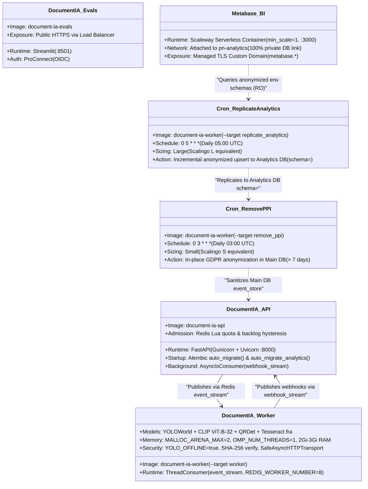

---

### 4.2. Network Topology: Shared VPC with Default-Deny ACL & 100% Private Databases

The diagram below illustrates the standard per-cluster network perimeter inside the **shared Regional VPC** (`docia-shared-vpc`, with Scaleway VPC Routing + default-deny VPC Network ACL):

```mermaid
flowchart TB
    subgraph INTERNET["Public Internet"]
        CLIENT["API Consumers"]
        EVAL_USER["Internal Evaluators & BI Users"]
        PROCONNECT["ProConnect (Gouv OIDC)"]
        WEBHOOK_DST["Customer Webhook Endpoints"]
        EXT_DOC["External Document Hosts<br/>(file_url HTTPS / Presigned S3)"]
        ALBERT["Albert API (DINUM)<br/>https://albert.api.etalab.gouv.fr/v1"]
    end

    subgraph SCW_SHARED["External DNS (OVH) & Scaleway Regional Services (fr-par — Reached via NAT)"]
        DNS["OVH DNS Zone<br/>api.* / console.* (A) · metabase.* (CNAME)"]
        S3_APP[("Scaleway Object Storage<br/>docia-env-documents<br/>(Private + 7d Lifecycle + Bucket Policy)")]
        REGISTRY["Shared Container Registry<br/>rg.fr-par.scw.cloud/docia-shared"]
        SECRETS["Scaleway Secret Manager<br/>(/docia/env/*)"]
        COCKPIT["Scaleway Cockpit (Project Singleton)<br/>(Managed Loki & Grafana)"]
    end

    subgraph SHARED_VPC["Shared Regional VPC (docia-shared-vpc — VPC Routing Enabled + Default-Deny VPC Network ACL)"]
        VPC_ACL["VPC Network ACL (default_policy=DROP)<br/>Allows ONLY: pn-&lt;env&gt; -> pn-analytics:5432 (+ return)<br/>Blocks ALL cross-env traffic"]

        subgraph ENV_PN["stacks/network — Environment Private Network (172.16.x.0/22 — ZERO PUBLIC IP ON NODES & DATA)"]
            LB["Scaleway Load Balancer (Single Public Ingress)<br/>Managed by Traefik CCM on Reserved IP - TCP L4 + Proxy Protocol v2"]
            PGW["Scaleway Public Gateway (NAT Egress & SSH Bastion)<br/>Reserved Static Outbound IP"]

            subgraph KAPSULE["stacks/cluster + stacks/apps — Kapsule Cluster (Private Node Pools: public_ip_disabled=True)"]
                INGRESS["Traefik + cert-manager<br/>Automated Let's Encrypt TLS 1.3 & Host Routing"]
                API["Deployment: document-ia-api<br/>(FastAPI + AsyncIoConsumer Webhooks)"]
                EVALS["Deployment: document-ia-evals<br/>(Streamlit Console + ProConnect Auth)"]
                WORKER["Deployment: document-ia-worker<br/>(ThreadConsumer + OCR/YOLO/CLIP/QRDet)"]
                KEDA["KEDA Operator<br/>(Redis Streams Lag Trigger)"]
                CRON_PPI["CronJob: remove-ppi<br/>(03:00 UTC - J+7 Anonymization)"]
                CRON_REPL["CronJob: replicate-analytics<br/>(05:00 UTC -> schema=<env>)"]
            end

            subgraph ENV_DATA["stacks/data (per env) — Managed Data Stores (Private Network Endpoints Only)"]
                PG_MAIN[("Scaleway RDB PostgreSQL Main<br/>(event_store, organization, api_key, webhook)")]
                REDIS[("Scaleway Managed Redis 7+<br/>(maxmemory-policy=noeviction)")]
            end
        end

        subgraph PN_ANALYTICS["stacks/analytics (env=shared) — Private Network pn-analytics (172.16.0.0/24)"]
            METABASE["Metabase Serverless Container<br/>(min_scale=1, Managed TLS Custom Domain)"]
            PG_ANALYTICS[("Shared RDB PostgreSQL Analytics (100% PRIVATE — ZERO PUBLIC IP)<br/>(Schemas & Grants via pulumi-postgresql)<br/>• schema 'public' : Metabase internal<br/>• schema 'staging' | 'sandbox' | 'prod' : anonymized events")]
        end
    end

    %% Inbound Traffic
    CLIENT -->|"HTTPS 443 (api.*)"| DNS
    EVAL_USER -->|"HTTPS 443 (console.* / metabase.*)"| DNS
    DNS -->|"api.* / console.* (A)"| LB
    DNS -->|"metabase.* (CNAME)"| METABASE
    LB -->|"TCP 80/443 + Proxy Protocol v2 (RFC 1918)"| INGRESS
    INGRESS -->|"api.*"| API
    INGRESS -->|"console.*"| EVALS

    %% East-West Private Network Traffic (Direct L2/L3)
    API -->|"Private SQL (5432)"| PG_MAIN
    API -->|"Lua Admission / Quotas / XADD (6379)"| REDIS
    EVALS -->|"Internal HTTP"| API
    WORKER -->|"XREADGROUP / XCLAIM / DLQ (6379)"| REDIS
    WORKER -->|"Private SQL Event Store (5432)"| PG_MAIN
    KEDA -->|"Inspect Consumer Group Lag (6379)"| REDIS
    KEDA -.->|"Scale 1..N Replicas & Nodes (HPA Cooldowns)"| WORKER
    CRON_PPI -->|"Anonymize J+7 Payloads (5432)"| PG_MAIN
    CRON_REPL -->|"1. Incremental Read (5432)"| PG_MAIN

    %% Private VPC-Routed Analytics Traffic (Zero Public IP)
    API & CRON_REPL -->|"Private VPC Route (5432)"| VPC_ACL
    VPC_ACL -->|"Allowed TCP 5432"| PG_ANALYTICS
    METABASE -->|"Private SQL on pn-analytics (5432)"| PG_ANALYTICS

    %% Outbound Traffic (NAT Egress via Public Gateway)
    API & WORKER & EVALS & CRON_REPL -->|"Default Route (NAT)"| PGW
    PGW -->|"Scaleway Backbone (HTTPS)"| S3_APP & REGISTRY & COCKPIT & SECRETS
    PGW -->|"OIDC HTTPS"| PROCONNECT
    PGW -->|"OCR & LLM (HTTPS)"| ALBERT
    PGW -->|"Anti-SSRF Pinned Socket (HTTPS)"| EXT_DOC
    PGW -->|"Webhook Notifications (HTTPS)"| WEBHOOK_DST
```

---

### 4.3. Topology Comparison Diagrams (Option A vs. Option B)

#### Topology A — Fully Symmetric (3 Dedicated Clusters & 3 Isolated PNs Inside the Shared VPC)

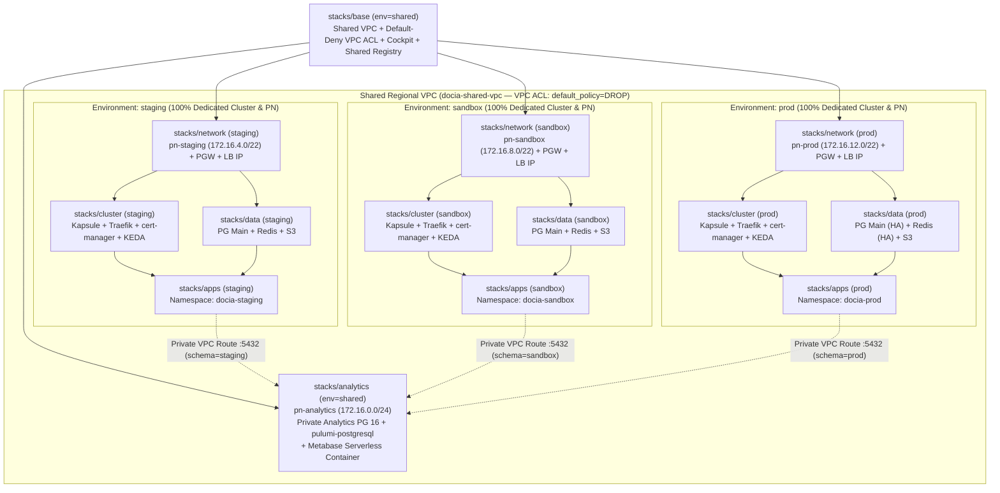

#### Topology B — 2 Clusters (`non-prod` Hosting `staging` + `sandbox`, Dedicated `prod` Inside the Shared VPC)

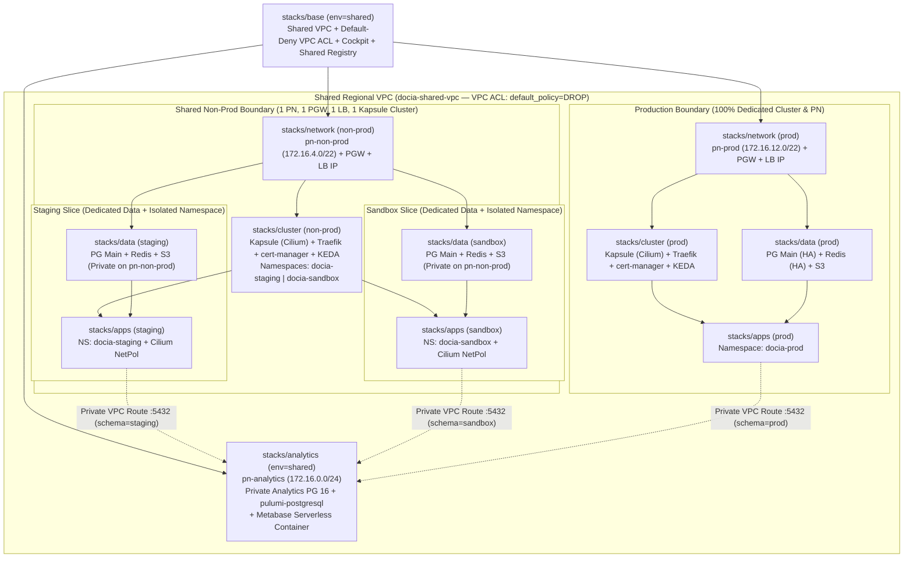

> [!NOTE]
> In **Topology B**, Cilium `NetworkPolicy` rules strictly isolate `docia-staging` and `docia-sandbox`: pods in `docia-staging` can only connect to `pg-main-staging`, `redis-staging`, and `pn-analytics:5432` (never to `sandbox` pods or `sandbox` databases), and vice versa. In both topologies, the **VPC Network ACL (`default_policy="drop"`)** prevents any packet from crossing between `pn-prod` and non-prod Private Networks.

---

### 4.4. Defense-in-Depth Network Security Matrix

| Source Component | Allowed Private Network Destinations | Allowed Outbound Egress (via Public Gateway NAT) | Blocked by VPC ACL, Application & Cilium `NetworkPolicy` |
|---|---|---|---|
| **Scaleway Load Balancer** | **Traefik** Controller (TCP 80/443 + Proxy Protocol v2) | *None* | Direct access to PostgreSQL, Redis, or Worker pods |
| **`document-ia-api`** | Own env `PostgreSQL Main (:5432)`, Own env `Redis (:6379)`, Shared Analytics RDB (`pn-analytics:5432`), `CoreDNS (:53)` | Scaleway S3, Cockpit Loki, Customer Webhook HTTPS endpoints (`:443`) | Any pod in another namespace (Topology B), other env PNs (VPC ACL), Worker or Evals pods |
| **`document-ia-worker`** | Own env `PostgreSQL Main (:5432)`, Own env `Redis (:6379)`, `CoreDNS (:53)` | Scaleway S3, Albert API (`:443`), External `file_url` (`:443` filtered by `SafeAsyncHTTPTransport`), Cockpit Loki | All RFC 1918 (`10/8`, `172.16/12`, `192.168/16`) including `pn-analytics`, CGNAT (`100.64/10`), Link-Local (`169.254/16`), API pods, other env data stores |
| **`document-ia-evals`** | Own env `document-ia-api (:8000)`, `CoreDNS (:53)` | ProConnect OIDC (`:443`), Scaleway S3, Cockpit Loki | Direct access to PostgreSQL Main, Analytics DB, or Redis |
| **`remove-ppi` CronJob** | Own env `PostgreSQL Main (:5432)`, `CoreDNS (:53)` | Cockpit Loki (`:443`) | All external Internet, S3, Redis, Analytics DB |
| **`replicate-analytics` CronJob** | Own env `PostgreSQL Main (:5432)`, Shared Analytics RDB (`pn-analytics:5432`), `CoreDNS (:53)` | Cockpit Loki (`:443`) | S3, Redis, arbitrary external hosts, other env PNs |
| **Metabase Serverless Container** | Shared Analytics RDB on `pn-analytics (:5432)` | Managed outbound HTTPS (e.g. SMTP / OIDC if configured) | All compute PNs (`pn-staging`, `pn-sandbox`, `pn-non-prod`, `pn-prod`) — blocked by VPC ACL `default_policy=drop` |

---

### 4.5. Shared Analytics & Metabase Architecture (`stacks/analytics`)

To preserve the multi-environment analytics design with **zero public IP on the database** and **zero coupling to Kubernetes clusters**, `stacks/analytics` (`env=shared`) provisions `pn-analytics`, the private PostgreSQL 16 instance, schema-level RBAC via `pulumi-postgresql`, and the Metabase Serverless Container:

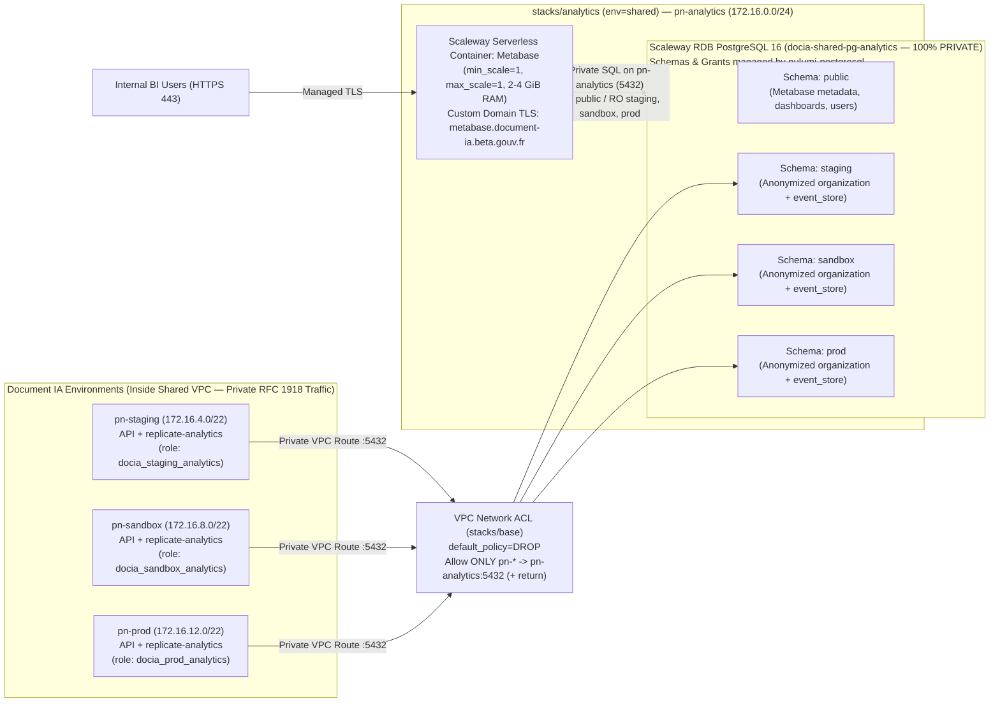

---

### 4.6. Event-Driven Worker Auto-Scaling (KEDA + HPA + Kapsule Cluster Autoscaler)

Worker scaling operates in **two coordinated tiers**—zero custom autoscaler daemon required:
1. **Pod Tier (KEDA + Kubernetes HPA)**: KEDA polls Redis Streams (`XINFO GROUPS event_stream`) every `30s`, computes desired worker replicas from consumer group lag (`lagCount`), and delegates step-rate limits and stabilization cooldowns to the underlying Kubernetes HPA (`behavior.scaleUp` / `behavior.scaleDown`).
2. **Node Tier (Scaleway Kapsule Cluster Autoscaler)**: Whenever a newly scheduled `document-ia-worker` pod (`2Gi`–`3Gi` RAM request) cannot fit on existing nodes in the `workers` pool, the pod enters `Pending` and Kapsule automatically provisions a new private VM node (`public_ip_disabled=True`) within `min_size..max_size` (~1m30–2m30), pulls the image over the local `fr-par` Scaleway Registry backbone, and later decommissions idle nodes after scale-down.

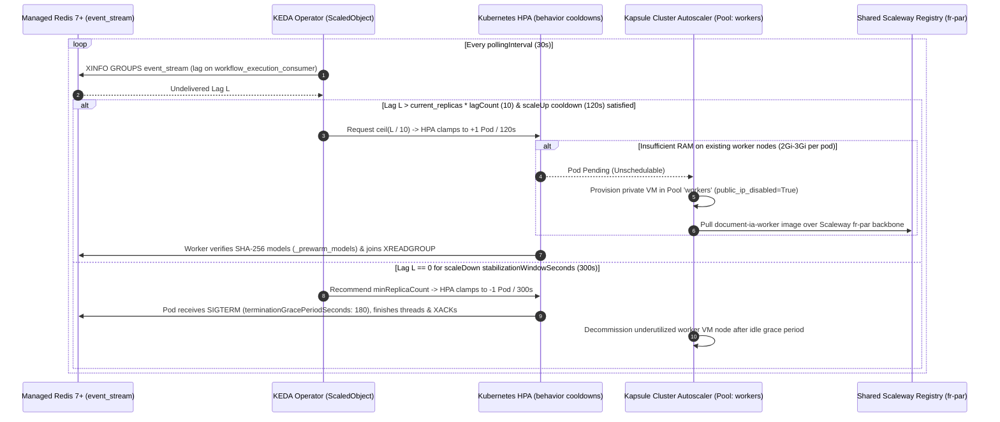

#### Parity Mapping with Legacy `document-ia-auto-scaler`

| Legacy `document-ia-auto-scaler` Parameter | KEDA + HPA Equivalent | Operational Effect |
|---|---|---|
| `CHECK_INTERVAL = 30` | `spec.pollingInterval: 30` | Polls Redis Streams lag every 30 seconds |
| `nb_execution_undelivered` (API `/health`) | Trigger `redis-streams` with **`lagCount: "10"`** | Scales on unconsumed consumer-group lag (`ceil(lag / 10)`), aligned with `THREAD_PER_WORKER` |
| `MIN_WORKERS` / `MAX_WORKERS` | `minReplicaCount` / `maxReplicaCount` | Enforces hot baseline replicas and hard upper bound per environment |
| `SCALE_UP_COOLDOWN = 120` (+1 worker/step) | `behavior.scaleUp`: `stabilizationWindowSeconds: 30` + policy **`+1 Pod / 120s`** | Prevents spawning multiple pods on transient micro-bursts; scales smoothly one worker at a time |
| `SCALE_DOWN_COOLDOWN = 300` (-1 worker/step) | `behavior.scaleDown`: **`stabilizationWindowSeconds: 300`** + policy **`-1 Pod / 300s`** | Requires 5 continuous minutes of calm before removing any pod, then scales down one worker every 5 minutes |
| Graceful worker drain | `Deployment` **`terminationGracePeriodSeconds: 180`** | Overrides K8s' 30s default so in-flight OCR / Albert calls finish and `XACK` cleanly on `SIGTERM` |

> [!IMPORTANT]
> **KEDA `cooldownPeriod` vs. HPA `stabilizationWindowSeconds`**:
> In KEDA, `spec.cooldownPeriod` applies **only** when scaling down from `1` to `0` (`minReplicaCount: 0`). Because Document IA keeps at least 1 warm worker (`minReplicaCount >= 1`), anti-flapping cooldowns between `N` and `minReplicaCount` **must** be configured via `spec.advanced.horizontalPodAutoscalerConfig.behavior.scaleDown`.

#### Reference `ScaledObject` Configuration (`stacks/apps`)

```yaml
apiVersion: keda.sh/v1alpha1
kind: ScaledObject
metadata:
  name: document-ia-worker-scaler
  namespace: docia-<env>
spec:
  scaleTargetRef:
    name: document-ia-worker
  pollingInterval: 30
  minReplicaCount: 1                # 1 in staging/sandbox, 1 or 2 in prod
  maxReplicaCount: 5                # Configurable per env (e.g. 2-3 staging/sandbox, 5-10 prod)
  advanced:
    horizontalPodAutoscalerConfig:
      behavior:
        scaleUp:
          stabilizationWindowSeconds: 30
          policies:
            - type: Pods
              value: 1
              periodSeconds: 120    # Max +1 worker every 2 min
        scaleDown:
          stabilizationWindowSeconds: 300  # 5 min sustained calm before scale-down
          policies:
            - type: Pods
              value: 1
              periodSeconds: 300    # Max -1 worker every 5 min
  triggers:
    - type: redis-streams
      metadata:
        address: "<redis_private_host>:6379"
        stream: "event_stream"
        consumerGroup: "workflow_execution_consumer"
        lagCount: "10"              # Target lag per worker replica (= THREAD_PER_WORKER)
```

#### Baseline Scaling Profiles by Environment

| Parameter | `staging` / `sandbox` | `prod` |
|---|---|---|
| **`document-ia-api` Replicas** | 1 (fixed) | $\ge 2$ (fixed + `PodDisruptionBudget`; optional CPU HPA) |
| **`document-ia-worker` `minReplicaCount` / `maxReplicaCount`** | `1` / `3` | `1`–`2` / `5`–`10` |
| **`lagCount` (Messages / Worker)** | `10` | `10` (aligned with `THREAD_PER_WORKER`) |
| **Scale-Up Policy** | `+1 Pod / 120s` (`stabilizationWindow: 30s`) | `+1 Pod / 120s` (`stabilizationWindow: 30s`) |
| **Scale-Down Policy** | `-1 Pod / 300s` (`stabilizationWindow: 300s`) | `-1 Pod / 300s` (`stabilizationWindow: 300s`) |
| **`terminationGracePeriodSeconds`** | `180` | `180` |
| **Kapsule `workers` Node Pool (`min_size..max_size`)** | `1..2` (`DEV1-M` 4 GiB) | `1..5` (`PRO2-S` 8 GiB, ~2–3 worker pods/node) |

---

### 4.7. Backup, Retention & Disaster Recovery Policy

All persistence layers rely on **Scaleway-native mechanisms** with strict regional residency (`backup_same_region=True` in `fr-par`), eliminating custom backup cron jobs while respecting Document IA's 7-day GDPR PPI retention rules.

#### Retention, Resilience & Recovery Matrix

| Component | Backup / Resilience Mechanism | Schedule / RPO | Retention | Sovereignty & Deletion Protection | Recovery Procedure (RTO) |
|---|---|---|---|---|---|
| **Main PostgreSQL (`pg-main` — `prod`)** | Scaleway RDB automated **Block Storage snapshots** (`DB-PRO2`) + **HA 2-node cluster** (`is_ha_cluster=True`) | **Every 6–12h** (logical RPO); **0s** on node crash (HA failover) | **7 days** *(GDPR-aligned with `remove-ppi` J+7)* | `backup_same_region=True` (`fr-par`), Pulumi `protect=True` | Restore snapshot into a new isolated RDB instance (~5–15 min) and repoint secret / re-import state |
| **Main PostgreSQL (`pg-main` — `staging` / `sandbox`)** | Scaleway RDB automated backups (1 node) | **Every 24h** | **7 days** | `backup_same_region=True` (`fr-par`) | Restore backup into a new RDB instance |
| **Shared Analytics PostgreSQL (`pg-analytics`)** | Scaleway RDB automated snapshots / backups | **Every 24h** | **30 days** *(zero PPI; protects Metabase `public` dashboards & historical metrics)* | `backup_same_region=True` (`fr-par`), Pulumi `protect=True` | Restore snapshot into a new RDB instance on `pn-analytics` |
| **Documents S3 Bucket (`docia-<env>-documents`)** | Native Scaleway Object Storage replication (**Multi-AZ** in `prod`) | Continuous (platform-managed) | **7-day automatic object expiration** (GDPR) + 1-day incomplete multipart abort | `fr-par`, private ACL + S3 Bucket Policy | No backup needed (ephemeral user documents) |
| **Managed Redis 7+ (`docia-<env>-redis`)** | **HA / Replica** in `prod` (ephemeral broker/queue; source of truth lives in `pg-main`) | N/A | Ephemeral (streams trimmed once processed) | Private Network only (`fr-par`) | Recreate via `make up stack=data` |
| **Pulumi State Bucket (S3)** | **Object Versioning** enabled by `scripts/bootstrap.sh` | Every state write | Historical state versions retained | `fr-par`, IAM-gated | Restore previous `.pulumi/stacks/<stack>/<env>.json` object version |
| **Scaleway Secret Manager** | Native secret versioning + `protected=True` | Every version update | Historical versions retained | `fr-par`, IAM-gated, Pulumi `protect=True` | Promote previous secret version |
| **Kapsule, Workloads, Metabase, Grafana & Alerts** | **100 % stateless / Declarative IaC in Git** | Every Git commit | Full Git history | Zero persistent local volumes | Rebuild deterministically via `make up` in DAG order |

> [!NOTE]
> **Scaleway RDB Snapshots vs. Continuous PITR & Non-Destructive Recovery Drills**:
> * Scaleway Managed PostgreSQL does not provide native second-by-second WAL Point-in-Time Recovery (PITR). For `prod` `pg-main`, setting `backup_schedule_frequency` to `6` or `12` hours narrows the logical RPO window without introducing custom WAL-shipping tooling.
> * Restoring a Scaleway RDB snapshot always provisions a **brand-new isolated database instance** without overwriting production, making **quarterly restore drills** on `staging` safe and fast to verify backup integrity.

---

### 4.8. Comprehensive Scaleway Resource Inventory & Sizing Matrix

#### Layer 0 — Stack `stacks/base` (`env=shared`, Project-Wide Shared Foundation & VPC Isolation)

| Resource | Pulumi Class (`pulumiverse_scaleway`) | Key Configuration | Scope |
|---|---|---|---|
| **Shared Regional VPC** | `network.Vpc` | `enable_routing=True` (`docia-shared-vpc`, `fr-par`); hosts all isolated Private Networks with non-overlapping CIDRs | Project-wide |
| **VPC Network ACL** | `network.Acl` | `default_policy="drop"` (`is_ipv6=False`); stateless rules allowing **only** `pn-<boundary> -> pn-analytics:5432` and matching return traffic (`5432 -> 1024-65535`); blocks all cross-env traffic | Project-wide |
| **Scaleway Cockpit** | `observability.Cockpit` | Activates managed Loki / Prometheus / Grafana once for Scaleway project `DocumentIA` | Project singleton |
| **Shared Container Registry** | `registry.Namespace` | `is_public=False`, regional `fr-par` OCI registry (`docia-shared`) hosting immutable images promoted across environments | Project-wide |
| **CI Registry IAM App** | `iam.Application` + `Policy` + `ApiKey` | Dedicated least-privilege `ContainerRegistryFullAccess` identity for GitHub Actions image pushes (`document-ia`) | Project-wide |

#### Layer 1A — Stack `stacks/network` (Per Topology Boundary: `staging`/`sandbox`/`prod` in Option A, `non-prod`/`prod` in Option B)

| Resource | Pulumi Class (`pulumiverse_scaleway`) | Key Configuration | Sizing (`staging`/`sandbox` or `non-prod`) | Sizing (`prod`) |
|---|---|---|---|---|
| **Private Network** | `network.PrivateNetwork` | Attached to shared `vpc_id` from `stacks/base` with non-overlapping IPAM CIDR (`172.16.4.0/22`, `172.16.8.0/22`, `172.16.12.0/22`) | `/22` subnet | `/22` subnet |
| **Public Gateway IP** | `vpcgw.Ip` | Static outbound IPv4 for NAT egress & optional SSH Bastion | 1 static IPv4 | 1 static IPv4 |
| **Public Gateway** | `vpcgw.Gateway` + `GatewayNetwork` | `enable_masquerade=True`, `bastion_enabled=True` (for private admin/DB tunneling), attached to `PrivateNetwork` | `VPC-GW-S` | `VPC-GW-M` |
| **Reserved Ingress IP** | `loadbalancers.Ip` | Static public IPv4 reserved early, pointed to by OVH DNS `A` records, and bound to Traefik via Scaleway CCM in `stacks/cluster` | 1 static IPv4 | 1 static IPv4 |
| **Cockpit Push Token** | `observability.Token` + `secrets.SecretVersion` | `scopes={"write_logs": True}`, token stored in Secret Manager (`/docia/<boundary>/cockpit-loki-token`) | 1 token per boundary | 1 token |

#### Layer 1B — Stack `stacks/analytics` (`env=shared`, Private Analytics RDB, Schema RBAC & Metabase Serverless Container)

| Resource | Pulumi Class (`pulumiverse_scaleway` / `pulumi_postgresql`) | Key Configuration | Sizing |
|---|---|---|---|
| **Analytics Private Network** | `scaleway.network.PrivateNetwork` | `docia-analytics-pn` (`172.16.0.0/24`) attached to shared `vpc_id` from `stacks/base` | `/24` subnet |
| **Analytics PostgreSQL (100% Private)** | `scaleway.databases.Instance` + `Database` + `Acl` | PostgreSQL 16 (`docia-shared-pg-analytics`), attached **exclusively to `docia-analytics-pn`**, **empty public ACL (zero public IP)**, `backup_same_region=True`, **24h schedule / 30-day retention**, Pulumi `protect=True` | `DB-DEV-M` or `DB-PRO2-XS` |
| **Schemas & Roles** | `postgresql.Schema` + `postgresql.Role` + `postgresql.Grant` + `postgresql.DefaultPrivileges` | Applied over private Bastion SSH tunnel: schemas `staging`, `sandbox`, `prod`; `metabase` role (RW `public`, RO env schemas); `docia_<env>_analytics` roles (RW own `<env>` schema) | Least-privilege schema RBAC |
| **Analytics Credentials** | `scaleway.secrets.Secret` + `SecretVersion` | `/docia/shared/metabase-db-credentials` and `/docia/<env>/analytics-db-credentials` | Scaleway Secret Manager |
| **Metabase Serverless Container** | `scaleway.containers.Namespace` + `Container` + `Domain` | `min_scale=1`, `max_scale=1`, `port=3000`, `private_network_id=docia-analytics-pn.id` (connects directly to Analytics PG private IP), managed Let's Encrypt TLS (`metabase.<domain>`) once OVH `CNAME` points to `metabase_cname_target` | 2–4 GiB RAM, 1–2 vCPU |

#### Layer 1C — Stack `stacks/observability` (`env=shared`, Grafana Dashboards & Alerting as Code)

| Resource | Pulumi Class (`pulumiverse_grafana` / `pulumiverse_scaleway`) | Key Configuration | Scope |
|---|---|---|---|
| **Grafana Provider (Cockpit IAM)** | `grafana.Provider` | Targets `cockpit_grafana_url` from `stacks/base` using `auth="anonymous"` and `http_headers={"X-Auth-Token": SCW_SECRET_KEY}` (no legacy user/password) | Project-wide |
| **Grafana Folder & Dashboards** | `grafana.oss.Folder` + `grafana.oss.Dashboard` | Custom `Document IA` folder hosting the 2+ versioned JSON dashboards from `stacks/observability/dashboards/*.json` (alongside Scaleway's built-in read-only product dashboards) | Project-wide |
| **Cockpit Alert Manager** | `scaleway.observability.AlertManager` | Enables selected Scaleway `preconfigured_alert_ids` (Kapsule, PostgreSQL RDB, Redis, Load Balancer) and configures notification `contact_points` | Project-wide |
| **Custom Loki / Mimir Rules** | Versioned YAML rules (`stacks/observability/alerts/`) pushed via Cockpit Ruler API | Application-level alerts on Loki logs & metrics (API error rates, worker failures, Redis DLQ / queue lag), routed through Cockpit Alert Manager | Project-wide |

#### Layer 2 — Stack `stacks/data` (Always Per Environment: `staging`, `sandbox`, `prod`)

| Resource | Pulumi Class (`pulumiverse_scaleway`) | Key Configuration | Sizing (`staging` / `sandbox`) | Sizing (`prod`) |
|---|---|---|---|---|
| **Documents S3 Bucket** | `object.Bucket` + `object.BucketPolicy` | `acl="private"`, **7-day object expiration lifecycle rule** aligned with `EVENT_STORE_PPI_RETENTION_DAYS=7` + 1-day `AbortIncompleteMultipartUpload`; **explicit S3 Bucket Policy** scoping `docia-<env>-s3-app` strictly to this bucket (and preventing access to the Pulumi state bucket in the same `DocumentIA` project) | Standard (`fr-par`) | Standard / Multi-AZ (`fr-par`) |
| **Runtime S3 IAM App** | `iam.Application` + `Policy` + `ApiKey` | `default_project_id` = `DocumentIA`; paired with S3 Bucket Policies for per-bucket isolation | 1 IAM App per env | 1 IAM App |
| **Main PostgreSQL RDB** | `databases.Instance` + `Database` + `User` + `Acl` | PostgreSQL 16 (`docia-<env>-pg-main`), attached **exclusively to `PrivateNetwork`** (empty public ACL), `backup_same_region=True`, **7-day GDPR-aligned retention** (`24h` non-prod / `6h`–`12h` prod), Pulumi `protect=True` in prod | `DB-DEV-S` (1 node) | `DB-PRO2-XS` or `S` (**HA 2 nodes**, Block SSD) |
| **Managed Redis 7+** | `redis.Cluster` | **Redis $\ge 7.0$ mandatory** (consumer-group lag in admission Lua script), **`settings={"maxmemory-policy": "noeviction"}` mandatory**, attached **exclusively to `PrivateNetwork`**, TLS enabled | `RED1-MICRO` (1 node) | `RED1-S` or `RED1-M` (**HA Cluster / Replica**, $\ge 2\text{ GiB}$) |
| **Application Secrets** | `secrets.Secret` + `SecretVersion` | `/docia/<env>/runtime-secrets` (`DOCUMENT_IA_API_KEY`, `API_KEY_PEPPER_HASH`, `API_KEY_PEPPER_CHK`, `WEBHOOK_SECRET_ENCRYPTION_KEY`, `OPENAI_API_KEY` Albert, DB/Redis/S3 URLs, ProConnect OIDC secrets) | Scaleway Secret Manager | Scaleway Secret Manager |

#### Layer 3 — Stack `stacks/cluster` (Per Topology Boundary: `staging`/`sandbox`/`prod` in Option A, `non-prod`/`prod` in Option B)

| Resource | Pulumi Class (`pulumiverse_scaleway` / `pulumi_kubernetes`) | Key Configuration | Sizing (`staging`/`sandbox` or `non-prod`) | Sizing (`prod`) |
|---|---|---|---|---|
| **Kapsule Cluster** | `scaleway.kubernetes.Cluster` | Managed control plane (`cni="cilium"`), attached to `PrivateNetwork` | Kapsule (free control plane) | Kapsule (free control plane) |
| **Node Pool `api-system`** | `scaleway.kubernetes.Pool` | **`public_ip_disabled=True`**, `autohealing=True`; runs API, Console/Evals, CronJobs, Traefik, `cert-manager`, KEDA | 1–2x `DEV1-M` (3 vCPU, 4 GiB) | 2–3x `PRO2-S` (2 vCPU, 8 GiB) |
| **Node Pool `workers`** | `scaleway.kubernetes.Pool` | **`public_ip_disabled=True`**, `autoscaling=True`, `autohealing=True`; dedicated to `document-ia-worker` pods (`2Gi`–`3Gi` RAM/pod, see [Section 4.6](#46-event-driven-worker-auto-scaling-keda--hpa--kapsule-cluster-autoscaler)) | 1..2x `DEV1-M` (4 GiB) | 1..5x `PRO2-S` (8 GiB, ~2–3 worker pods/node) |
| **Traefik Gateway + LB** | `helm.v3.Release` (`traefik`) | Provisioned with Scaleway CCM annotations binding the single Scaleway Load Balancer (`LB-S` / `LB-GP-M`) to `lb_reserved_ip_id` in **TCP L4 + Proxy Protocol v2** mode (no duplicate `loadbalancers.Lb` resource) | 1 LB per cluster | 1 LB |
| **Automated TLS (`cert-manager`)** | `helm.v3.Release` (`cert-manager`) + `ClusterIssuer` | ACME Let's Encrypt **HTTP-01** `ClusterIssuer` (`letsencrypt-prod`); issues & renews TLS 1.3 certs automatically for every `Ingress` (DNS-provider agnostic, works with OVH) | 1 per cluster | 1 |
| **KEDA Operator** | `helm.v3.Release` (`keda`) | Installs KEDA controller & `ScaledObject` CRDs before `stacks/apps` runs | 1 per cluster | 1 |
| **Kubernetes Namespaces** | `core.v1.Namespace` | Option A: `docia-<env>` / Option B: `docia-staging` + `docia-sandbox` (on `non-prod`), `docia-prod` (on `prod`) | 1 or 2 namespaces | 1 namespace |
| **Kubeconfig Secret** | `scaleway.secrets.SecretVersion` | Stores cluster kubeconfig in Secret Manager (`/docia/<boundary>/kubeconfig`) so `stacks/apps` consumes only a `secret_id` (zero plaintext kubeconfig in `stack_data`) | Scaleway Secret Manager | Scaleway Secret Manager |

#### Layer 4 — Stack `stacks/apps` (Always Per Environment: `staging`, `sandbox`, `prod`)

| Resource | Pulumi Class (`pulumi_kubernetes`) | Key Configuration | Sizing (`staging` / `sandbox`) | Sizing (`prod`) |
|---|---|---|---|---|
| **Runtime Secrets** | `core.v1.Secret` (`docia-runtime-env`) | Materialized directly by Pulumi from `stacks/data` (`runtime_secrets_id`), `stacks/analytics` (`analytics_credentials_secret_id`), and `stacks/network` (`cockpit_token_secret_id`) | 1 Secret per env namespace | 1 Secret |
| **Cilium Isolation** | `networking.v1.NetworkPolicy` | Strict East-West & anti-SSRF rules isolating pods to their own env's Main RDB, Redis, `pn-analytics:5432` (for API & `replicate-analytics` only), and authorized egress | Applied per env namespace | Applied per env namespace |
| **API & Console (Evals)** | `apps.v1.Deployment` + `core.v1.Service` | • `document-ia-api` (`AUTO_MIGRATE=true`, `/api/v1/health` probes)<br/>• `document-ia-evals` (Streamlit Console + ProConnect OIDC) | 1 API replica, 1 Console replica | $\ge 2$ API replicas (PDB), 1–2 Console replicas |
| **Workers & KEDA** | `apps.v1.Deployment` + `keda.sh/v1alpha1.ScaledObject` | `document-ia-worker` (prewarms 4 SHA-256 AI models, consumes `event_stream`, `terminationGracePeriodSeconds: 180`) + KEDA `ScaledObject` (`lagCount: "10"`, `+1/120s` up, `300s` stabilization & `-1/300s` down) | 1..3 replicas | 1–2..5–10 replicas |
| **Scheduled Jobs** | `batch.v1.CronJob` | • `remove-ppi` (`0 3 * * *`, size `S` equivalent)<br/>• `replicate-analytics` (`0 5 * * *`, `ANALYTICS_POSTGRES_SCHEMA=<env>`, size `L` equivalent) | 2 CronJobs | 2 CronJobs |
| **Ingress (Automated TLS)** | `networking.v1.Ingress` | Host-based TLS 1.3 routing (`api.<env>.*`, `console.<env>.*`; prod: `api.*`, `console.*`) targeting **Traefik** with `cert-manager.io/cluster-issuer: letsencrypt-prod` (DNS `A` records hosted on OVH) | Per-env hostnames | Prod hostnames |

---

## 5. Stack-by-Stack Decomposition & Inter-Stack Dependency Contracts

To eliminate circular dependencies, separate cluster lifecycle from application deployments, isolate observability changes from core networking, keep all databases 100 % private, and support both isolation topologies cleanly, the infrastructure is decomposed into **7 layered Pulumi stacks** forming a strict **Directed Acyclic Graph (DAG)**.

### 5.1. Global Inter-Stack Dependency DAG & Deployment Ordering

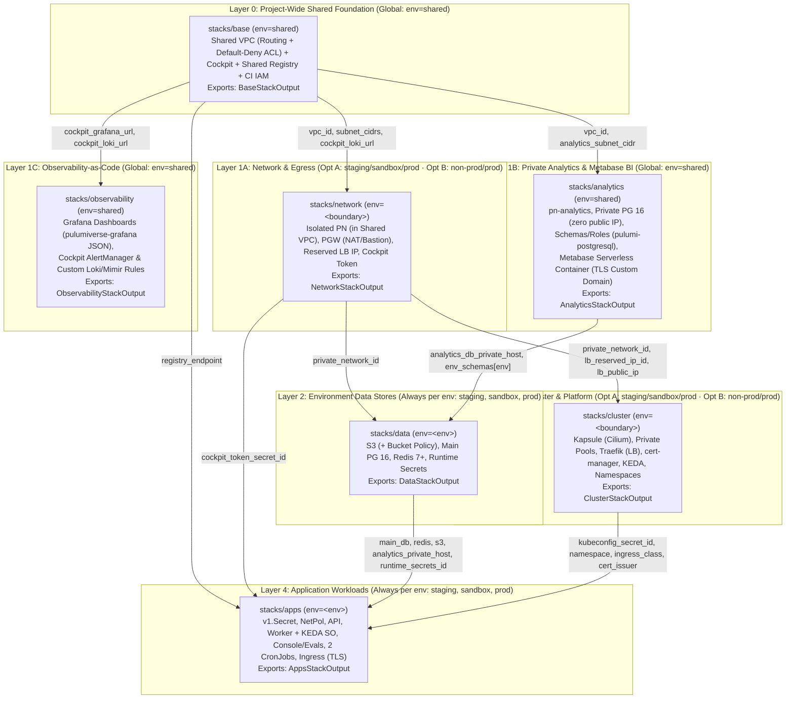

#### Deterministic Rollout & Teardown Sequence

Because `stacks/analytics` and `stacks/observability` depend only on `stacks/base`, **Layer 1A (`stacks/network`), Layer 1B (`stacks/analytics`), and Layer 1C (`stacks/observability`) have no dependency on each other** (note: deploying at least one `stacks/network` first provides the SSH Bastion used to run `pulumi-postgresql` against the private Analytics RDB). Once `stacks/network` and `stacks/analytics` are up, configure the static `A` / `CNAME` records in **OVH** using their exported `lb_public_ip` and `metabase_cname_target` outputs so Let's Encrypt validation succeeds automatically.

1. **Provisioning (`make up`) — Topology A (Fully Symmetric: 3 Clusters)**:
   ```bash
   # Layer 0: Shared VPC + Default-Deny VPC ACL + Cockpit + Shared Registry
   make up stack=base env=shared

   # Layer 1A: Per-environment isolated Private Networks, PGWs (NAT/Bastion) & Reserved LB IPs
   make up stack=network env=staging
   make up stack=network env=sandbox
   make up stack=network env=prod

   # Layer 1B: Private pn-analytics + Analytics PG 16 + schemas (via Bastion SSH tunnel) + Metabase Serverless Container
   make up stack=analytics env=shared

   # Layer 1C: Grafana dashboards (JSON), Cockpit AlertManager & custom Loki/Mimir alert rules
   make up stack=observability env=shared

   # -> One-time OVH DNS setup: point api.*, console.* (A) -> lb_public_ip & metabase.* (CNAME) -> metabase_cname_target

   # Layer 2: Per-environment S3, Main PostgreSQL, Redis 7+ & Secret Manager bundles
   make up stack=data env=staging
   make up stack=data env=sandbox
   make up stack=data env=prod

   # Layer 3: Per-environment Kapsule clusters, Traefik (LB), cert-manager, KEDA & Namespaces
   make up stack=cluster env=staging
   make up stack=cluster env=sandbox
   make up stack=cluster env=prod

   # Layer 4: Per-environment application workloads (API, Workers, Console/Evals, 2 CronJobs, Ingress TLS)
   make up stack=apps env=staging
   make up stack=apps env=sandbox
   make up stack=apps env=prod
   ```
2. **Provisioning (`make up`) — Topology B (2 Clusters: `non-prod` + `prod`)**:
   ```bash
   # Layer 0: Shared VPC + Default-Deny VPC ACL + Cockpit + Shared Registry
   make up stack=base env=shared

   # Layer 1A: Two network boundaries (non-prod + prod) inside the shared VPC
   make up stack=network env=non-prod
   make up stack=network env=prod

   # Layer 1B: Private pn-analytics + Analytics PG 16 + schemas (via Bastion SSH tunnel) + Metabase Serverless Container
   make up stack=analytics env=shared

   # Layer 1C: Grafana dashboards (JSON), Cockpit AlertManager & custom Loki/Mimir alert rules
   make up stack=observability env=shared

   # -> One-time OVH DNS setup: point staging/sandbox api.*, console.* (A) -> non-prod lb_public_ip,
   #    prod api.*, console.* (A) -> prod lb_public_ip, and metabase.* (CNAME) -> metabase_cname_target

   # Layer 2: Per-environment isolated data stores (staging & sandbox attach to network=non-prod)
   make up stack=data env=staging
   make up stack=data env=sandbox
   make up stack=data env=prod

   # Layer 3: Two Kapsule clusters (non-prod with namespaces docia-staging & docia-sandbox, prod dedicated)
   make up stack=cluster env=non-prod
   make up stack=cluster env=prod

   # Layer 4: Per-environment application workloads (staging & sandbox target cluster=non-prod)
   make up stack=apps env=staging
   make up stack=apps env=sandbox
   make up stack=apps env=prod
   ```
3. **Teardown (`make destroy`)**: Always execute in the exact **reverse topological order** (`apps` $\rightarrow$ `cluster` $\rightarrow$ `data` $\rightarrow$ `observability` & `analytics` & `network` $\rightarrow$ `base`) so Kubernetes and managed services release all `PrivateNetwork` DHCP leases before the `PrivateNetwork`s and shared `VPC` are deleted.

### 5.2. Security Rule for Cross-Stack Contracts (`STACK_DATA_KEY`)

> [!IMPORTANT]
> **Zero Plaintext Secrets in Cross-Stack Outputs (`stack_data`)**:
> Every stack exports a single typed dictionary under `STACK_DATA_KEY = "stack_data"` consumed via `infra_lib.get_stack_data(project_name, env)` (`organization/<project_name>/<env>`).
> * **Never export raw passwords, kubeconfigs, API tokens, or private keys in `stack_data`**.
> * Upstream stacks (`base`, `network`, `analytics`, `data`, `cluster`) write sensitive credentials directly into **Scaleway Secret Manager** (`scaleway.secrets.Secret` + `SecretVersion`) and export only the **Secret UUID (`secret_id`)** and non-sensitive network coordinates (`ip`, `host`, `port`, `bucket_name`, `namespace`) in `outputs.py`.

---

### 5.3. Layer 0 — `stacks/base` (Project-Wide Shared Foundation & VPC ACL)

* **Scope**: Global shared stack (`env="shared"`).
* **Upstream Stack Dependencies**: **None** (DAG root).

#### Intra-Stack Resource Dependency Graph (`stacks/base`)

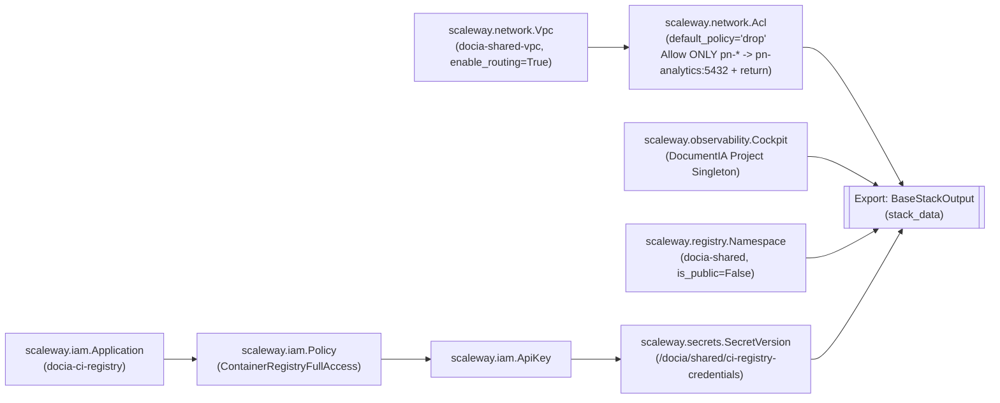

#### Typed Output Contract (`stacks/base/outputs.py`)

```python
class BaseStackOutput(TypedDict):
    region: str
    vpc_id: str                       # Shared Regional VPC (docia-shared-vpc)
    analytics_subnet_cidr: str        # e.g. "172.16.0.0/24"
    boundary_subnet_cidrs: dict[str, str]  # e.g. {"staging": "172.16.4.0/22", ...} or {"non-prod": "172.16.4.0/22", "prod": "172.16.12.0/22"}
    cockpit_grafana_url: str          # Cockpit Grafana URL (consumed by stacks/observability)
    cockpit_loki_url: str             # https://logs.cockpit.fr-par.scw.cloud/loki/api/v1/push
    registry_namespace_id: str
    registry_endpoint: str            # rg.fr-par.scw.cloud/docia-shared
    ci_registry_secret_id: str        # Scaleway Secret Manager UUID for CI image pushes
```

---

### 5.4. Layer 1A — `stacks/network` (Per-Boundary Private Network, NAT/Bastion & Reserved Ingress IP)

* **Scope**: Instantiated per network boundary (`staging`, `sandbox`, `prod` in Topology A; `non-prod`, `prod` in Topology B).
* **Upstream Stack Dependencies**: `stacks/base` (`env="shared"`) $\rightarrow$ provides `vpc_id`, `boundary_subnet_cidrs[boundary]`, and `cockpit_loki_url`.

#### Intra-Stack Resource Dependency Graph (`stacks/network`)

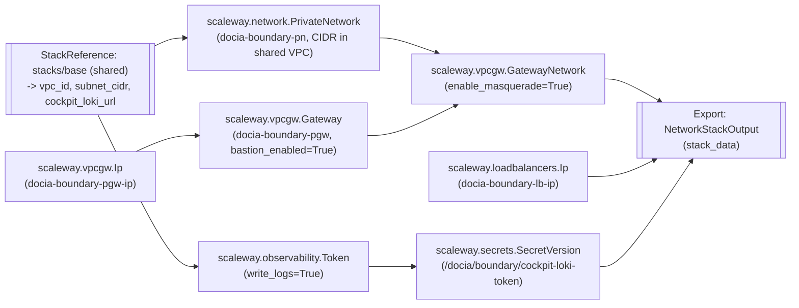

#### Typed Output Contract (`stacks/network/outputs.py`)

```python
class NetworkStackOutput(TypedDict):
    boundary: str                     # e.g. "staging", "sandbox", "non-prod", "prod"
    region: str
    zone: str
    vpc_id: str                       # Forwarded from stacks/base
    private_network_id: str
    private_subnet_cidr: str
    pgw_id: str
    pgw_network_id: str
    pgw_public_ip: str                # Static egress IPv4 & SSH Bastion endpoint
    lb_reserved_ip_id: str            # Bound to Traefik Load Balancer in stacks/cluster
    lb_public_ip: str                 # Static public ingress IPv4 (target for OVH DNS 'A' records)
    cockpit_loki_url: str
    cockpit_token_secret_id: str      # Scaleway Secret Manager UUID holding LOKI_BEARER_TOKEN
```

---

### 5.5. Layer 1B — `stacks/analytics` (Private Analytics PG 16, Schema RBAC & Metabase Serverless Container)

* **Scope**: Global shared stack (`env="shared"`).
* **Upstream Stack Dependencies**:
  * `stacks/base` (`env="shared"`) $\rightarrow$ `vpc_id` and `analytics_subnet_cidr` (`172.16.0.0/24`).
* **100 % Private DB & Decoupled Metabase**:
  * `docia-shared-pg-analytics` attaches exclusively to `docia-analytics-pn` with an empty public ACL (zero public IP).
  * Uses `pulumi-postgresql` (tunneled through a Public Gateway SSH Bastion) to create schemas (`staging`, `sandbox`, `prod`) and least-privilege schema grants.
  * Deploys **Metabase** as a **Scaleway Serverless Container** (`min_scale=1`, `max_scale=1`, `private_network_id=docia-analytics-pn.id`) with a managed TLS custom domain (`metabase.document-ia.beta.gouv.fr`).

#### Intra-Stack Resource Dependency Graph (`stacks/analytics`)

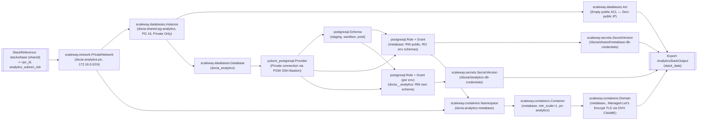

#### Typed Output Contract (`stacks/analytics/outputs.py`)

```python
class AnalyticsEnvSchemaContract(TypedDict):
    schema_name: str                  # e.g. "staging", "sandbox", "prod"
    db_user: str                      # e.g. "docia_staging_analytics"
    credentials_secret_id: str        # Scaleway Secret Manager UUID for this schema's writer user


class AnalyticsStackOutput(TypedDict):
    analytics_private_network_id: str
    analytics_subnet_cidr: str        # "172.16.0.0/24"
    analytics_instance_id: str
    analytics_db_private_host: str    # Private Network IP (172.16.0.x — zero public IP)
    analytics_db_port: int            # 5432
    analytics_db_name: str            # "docia_analytics"
    metabase_cname_target: str        # Scaleway Serverless Container default domain (target for OVH CNAME)
    metabase_url: str                 # https://metabase.<domain>
    metabase_db_user: str             # "metabase"
    metabase_credentials_secret_id: str
    env_schemas: dict[str, AnalyticsEnvSchemaContract]
```

---

### 5.6. Layer 1C — `stacks/observability` (Grafana Dashboards & Cockpit Alerting as Code)

* **Scope**: Global shared stack (`env="shared"`).
* **Upstream Stack Dependencies**:
  * `stacks/base` (`env="shared"`) $\rightarrow$ `cockpit_grafana_url`, `cockpit_loki_url` (ensures Cockpit is activated before provisioning dashboards and alerts).
* **Zero Blast Radius**: Iterating on dashboard JSON files or alert thresholds never runs against `stacks/base` (VPC / Network ACL) or any Kubernetes cluster.

#### Intra-Stack Resource Dependency Graph (`stacks/observability`)

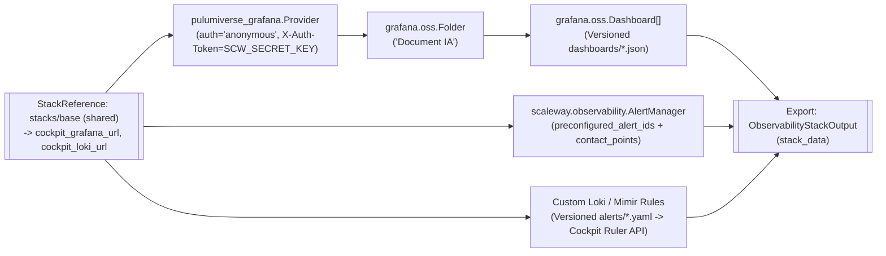

#### Typed Output Contract (`stacks/observability/outputs.py`)

```python
class ObservabilityStackOutput(TypedDict):
    grafana_url: str                  # Cockpit Grafana URL
    grafana_folder_uid: str           # UID of the 'Document IA' Grafana folder
    dashboard_uids: list[str]         # Provisioned dashboard UIDs
    alert_manager_enabled: bool
```

---

### 5.7. Layer 2 — `stacks/data` (Per-Environment S3, Main PostgreSQL, Redis 7+ & Secrets)

* **Scope**: **Always** instantiated per environment (`staging`, `sandbox`, `prod`) in both Topology A and Topology B.
* **Upstream Stack Dependencies**:
  1. `stacks/network` (`get_network_stack_output(network_env)`) $\rightarrow$ `private_network_id` (where `network_env` defaults to `ctx.env` in Topology A, or `"non-prod"` for `staging`/`sandbox` in Topology B).
  2. `stacks/analytics` (`get_analytics_stack_output("shared")`) $\rightarrow$ `analytics_db_private_host`, `analytics_db_port`, `analytics_db_name`, and `env_schemas[ctx.env]`.

#### Intra-Stack Resource Dependency Graph (`stacks/data`)

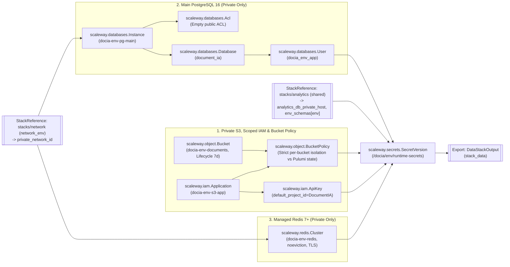

#### Typed Output Contract (`stacks/data/outputs.py`)

```python
class DataStackOutput(TypedDict):
    env: str
    network_boundary: str             # e.g. "staging" (Opt A) or "non-prod" (Opt B)
    s3_bucket_name: str
    s3_endpoint_url: str              # https://s3.fr-par.scw.cloud
    s3_region: str                    # fr-par
    s3_iam_application_id: str
    pg_main_instance_id: str
    pg_main_private_host: str         # Private Network IP (172.16.x.x)
    pg_main_port: int                 # 5432
    pg_main_db_name: str              # document_ia
    redis_cluster_id: str
    redis_private_host: str           # Private Network IP (172.16.x.x)
    redis_port: int                   # 6379
    redis_tls_enabled: bool           # True
    runtime_secrets_id: str           # Scaleway Secret Manager UUID (/docia/<env>/runtime-secrets)
    analytics_db_private_host: str    # Forwarded private IP (172.16.0.x) from stacks/analytics
    analytics_db_port: int
    analytics_db_name: str
    analytics_db_schema: str          # ANALYTICS_POSTGRES_SCHEMA=<env>
    analytics_credentials_secret_id: str
```

---

### 5.8. Layer 3 — `stacks/cluster` (Kapsule Private Cluster, Operators & Namespaces)

* **Scope**: Instantiated per cluster boundary (`staging`, `sandbox`, `prod` in Topology A; `non-prod`, `prod` in Topology B).
* **Upstream Stack Dependencies**:
  1. `stacks/network` (`get_network_stack_output(ctx.env)`) $\rightarrow$ `private_network_id`, `lb_reserved_ip_id`, `lb_public_ip`.

#### Intra-Stack Resource Dependency Graph (`stacks/cluster`)

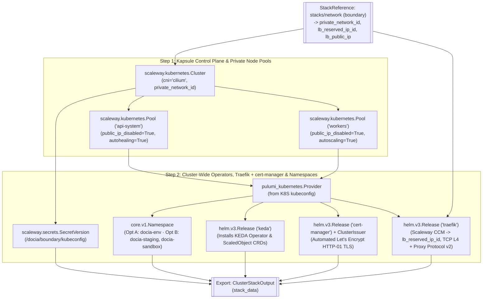

#### Typed Output Contract (`stacks/cluster/outputs.py`)

```python
class ClusterStackOutput(TypedDict):
    boundary: str                     # e.g. "staging", "non-prod", "prod"
    kapsule_cluster_id: str
    kapsule_version: str
    api_system_pool_id: str
    workers_pool_id: str
    kubeconfig_secret_id: str         # Scaleway Secret Manager UUID (/docia/<boundary>/kubeconfig)
    ingress_class_name: str           # "traefik"
    cert_manager_issuer_name: str     # "letsencrypt-prod"
    load_balancer_ip: str             # Forwarded from stacks/network (for reference / OVH DNS)
    namespaces: dict[str, str]        # e.g. {"staging": "docia-staging", "sandbox": "docia-sandbox"}
```

---

### 5.9. Layer 4 — `stacks/apps` (Per-Environment Application Workloads, Policies & Automated TLS Ingress)

* **Scope**: **Always** instantiated per environment (`staging`, `sandbox`, `prod`) in both Topology A and Topology B.
* **Upstream Stack Dependencies**:
  1. `stacks/base` (`env="shared"`) $\rightarrow$ `registry_endpoint`, `cockpit_loki_url`.
  2. `stacks/network` (`network_env`) $\rightarrow$ `cockpit_token_secret_id`.
  3. `stacks/data` (`ctx.env`) $\rightarrow$ `s3_bucket_name`, `pg_main_private_host`, `redis_private_host`, `runtime_secrets_id`, `analytics_db_private_host`, `analytics_db_*`, `analytics_credentials_secret_id`.
  4. `stacks/cluster` (`cluster_env`) $\rightarrow$ `kubeconfig_secret_id`, `namespaces[ctx.env]`, `ingress_class_name`, `cert_manager_issuer_name`.

#### Intra-Stack Resource Dependency Graph (`stacks/apps`)

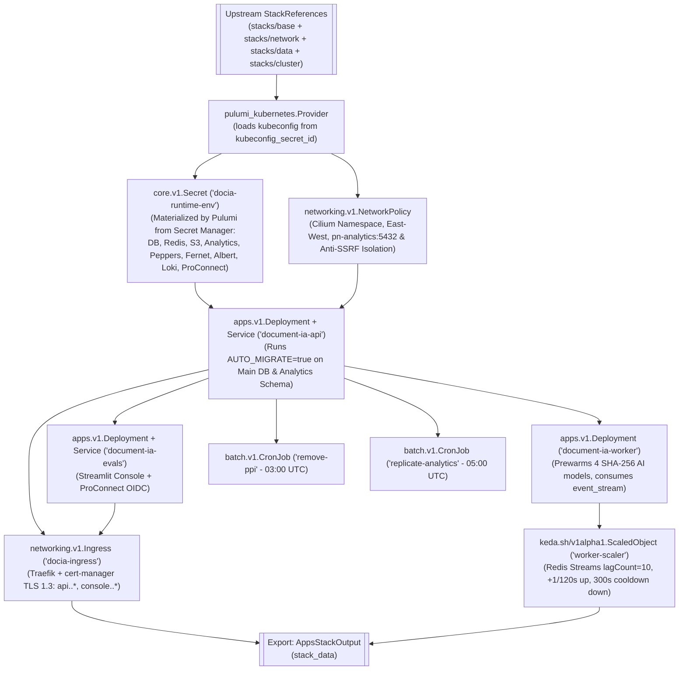

#### Typed Output Contract (`stacks/apps/outputs.py`)

```python
class AppsStackOutput(TypedDict):
    env: str
    cluster_boundary: str             # e.g. "staging" (Opt A) or "non-prod" (Opt B)
    namespace: str                    # e.g. "docia-staging"
    api_url: str                      # https://api.<env>.<domain> (prod: https://api.<domain>)
    console_url: str                  # https://console.<env>.<domain> (prod: https://console.<domain>)
```

---

### 5.10. Cross-Stack Dependency Matrix (Producer $\rightarrow$ Consumer Summary)

| Exported Output Field | Producer Stack | Consumer Stack(s) | Purpose in Consumer Stack |
|---|---|---|---|
| `vpc_id` / `boundary_subnet_cidrs` / `analytics_subnet_cidr` | `stacks/base (shared)` | `stacks/network (<boundary>)`<br/>`stacks/analytics (shared)` | Attach every isolated `PrivateNetwork` (and `pn-analytics`) to the shared VPC under the default-deny VPC Network ACL |
| `cockpit_grafana_url` / `cockpit_loki_url` | `stacks/base (shared)` | `stacks/observability (shared)`<br/>`stacks/network (<boundary>)`<br/>`stacks/apps (<env>)` | Provision Grafana dashboards & Cockpit alerts in `stacks/observability`, create scoped push tokens, and supply `LOKI_URL` |
| `registry_endpoint` | `stacks/base (shared)` | `stacks/apps (<env>)` | Immutable container image references (`rg.fr-par.scw.cloud/docia-shared/...`) for API, Worker, Console/Evals, and CronJobs |
| `private_network_id` | `stacks/network (<boundary>)` | `stacks/data (<env>)`<br/>`stacks/cluster (<boundary>)` | Attach Main PostgreSQL RDB, Managed Redis 7+, Kapsule Cluster, and Load Balancer backend to the boundary's private network |
| `lb_reserved_ip_id` / `lb_public_ip` | `stacks/network (<boundary>)` | `stacks/cluster (<boundary>)`<br/>*(OVH DNS `A` records)* | Bind the single Scaleway Load Balancer via Traefik CCM and expose the fixed IPv4 to point OVH DNS `A` records (`api.*`, `console.*`) |
| `cockpit_token_secret_id` | `stacks/network (<boundary>)` | `stacks/apps (<env>)` | Materialize `LOKI_BEARER_TOKEN` in `docia-runtime-env` Kubernetes Secret |
| `analytics_db_private_host` / `port` / `name` | `stacks/analytics (shared)` | `stacks/data (<env>)`<br/>`stacks/apps (<env>)` | Configure private VPC-routed `ANALYTICS_POSTGRES_*` (`172.16.0.x:5432`) on `document-ia-api`, `replicate-analytics` CronJob, and Cilium `NetworkPolicy` |
| `env_schemas[<env>]` | `stacks/analytics (shared)` | `stacks/data (<env>)`<br/>`stacks/apps (<env>)` | Provide `ANALYTICS_POSTGRES_SCHEMA=<env>` and schema-scoped `pulumi-postgresql` writer credentials secret ID |
| `metabase_cname_target` | `stacks/analytics (shared)` | *(OVH DNS `CNAME` record)* | Target hostname for `metabase.<domain>` in OVH enabling native Let's Encrypt TLS on the Metabase Serverless Container |
| `pg_main_private_host` / `redis_private_host` | `stacks/data (<env>)` | `stacks/apps (<env>)` | Configure Cilium `NetworkPolicy` allowlists (`:5432`, `:6379`) and KEDA `ScaledObject` Redis Stream address |
| `s3_bucket_name` / `s3_endpoint_url` | `stacks/data (<env>)` | `stacks/apps (<env>)` | Configure `S3_BUCKET_NAME` and `S3_ENDPOINT_URL` on `document-ia-api` and `document-ia-worker` |
| `runtime_secrets_id` | `stacks/data (<env>)` | `stacks/apps (<env>)` | Materialize the Kubernetes `v1.Secret` (`docia-runtime-env`) directly in `stacks/apps` |
| `kubeconfig_secret_id` / `namespaces[<env>]` / `ingress_class_name` / `cert_manager_issuer_name` | `stacks/cluster (<boundary>)` | `stacks/apps (<env>)` | Authenticate `pulumi_kubernetes.Provider`, target the environment's Namespace, and attach Traefik + `cert-manager` TLS to `Ingress` |

---

## 6. Repository Layout

```text
document-ia-infra/
├── flake.nix                  # Reproducible Nix DevShell (Python 3.14, uv, Pulumi, scw, awscli2)
├── flake.lock                 # Pinned nixpkgs revision
├── infra.env                  # Generic non-sensitive config (region, zone, vault path/name)
├── .env.local.example         # Template for developer-local Scaleway credentials
├── .envrc.example             # Optional direnv integration (`use flake`)
├── pyproject.toml             # uv project & dev tooling config (Ruff, Pyright, Hatchling)
├── uv.lock                    # Locked Python dependency graph
├── pyrightconfig.json         # Strict Pyright configuration shared with Pulumi
├── Makefile                   # Standard operational targets (bootstrap, preview, up, destroy, check)
├── docs/
│   ├── ARCHITECTURE.md                  # This document (ADRs, target cloud topology & stack contracts)
│   ├── SECURITY_AND_SECRETS.md          # Security model, isolation matrix & IAM guidelines
│   └── VULNERABILITY_MANAGEMENT_POLICY.md # CI/CD security policy (OSV/D7, Gitleaks, Dependabot)
├── scripts/
│   ├── load_env.sh                      # Sourced by flake.nix: isolation, vault loader, S3 profile setup
│   ├── bootstrap.sh                     # Idempotent one-time initialization (state bucket + vault secret)
│   ├── check_vulnerability_policy.py    # Policy D7 validator & OSV Union-Find deduplication
│   ├── verify_gitleaks_synthetic.sh     # Synthetic Gitleaks probes & .env.local.example check
│   ├── pre-push                         # Multi-ref Git pre-push hook wrapper
│   └── gitleaks_pre_push.sh             # Outgoing commits Gitleaks scanner
├── lib/infra_lib/
│   ├── config.py              # InfraContext, resource_name(), default_tags()
│   └── stack_output.py        # Typed StackReference helpers for S3 self-managed backend
└── stacks/
    ├── test/                  # Initial validation stack (zero-cost by default)
    ├── base/                  # Layer 0 (shared): Shared VPC + Default-Deny VPC ACL, Cockpit singleton, Shared Registry, CI IAM
    ├── network/               # Layer 1A (per boundary): Isolated Private Network, Public Gateway (NAT/Bastion), Reserved LB IP, Cockpit Token
    ├── analytics/             # Layer 1B (shared): pn-analytics, Private Analytics PG 16, Schemas/Roles (pulumi-postgresql), Metabase Serverless Container
    ├── observability/         # Layer 1C (shared): Grafana dashboards (JSON via pulumiverse-grafana), Cockpit AlertManager & custom Loki/Mimir alert rules
    ├── data/                  # Layer 2 (per env): S3 (+ 7d Lifecycle + Bucket Policy), Main PG 16, Redis 7+, Secrets
    ├── cluster/               # Layer 3 (per boundary): Kapsule Private Cluster (Cilium), Node Pools, Traefik + cert-manager, KEDA, Namespaces
    └── apps/                  # Layer 4 (per env): v1.Secret, NetPol, API, Worker + KEDA SO, Console/Evals, 2 CronJobs, Ingress (TLS)
```
