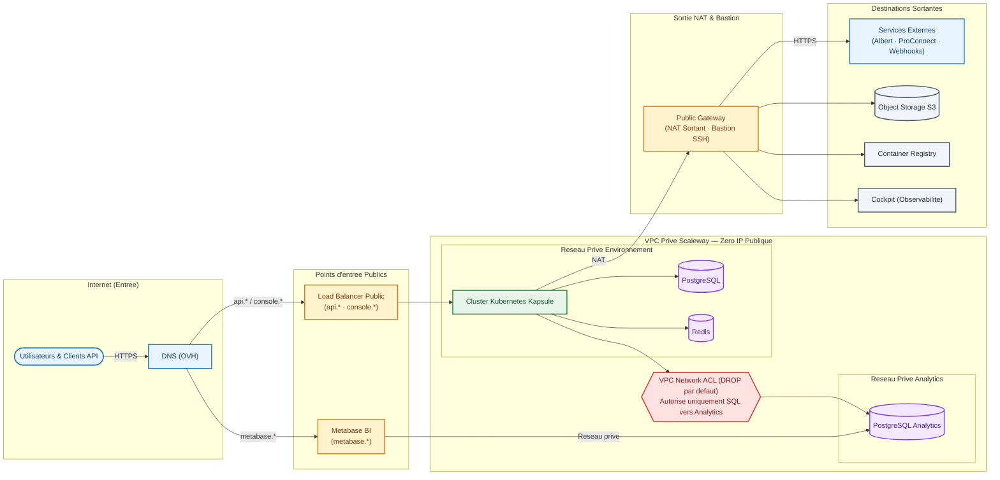
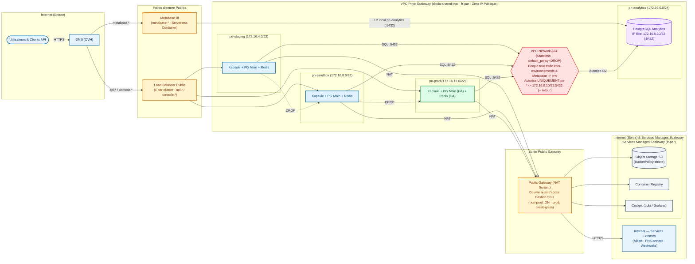
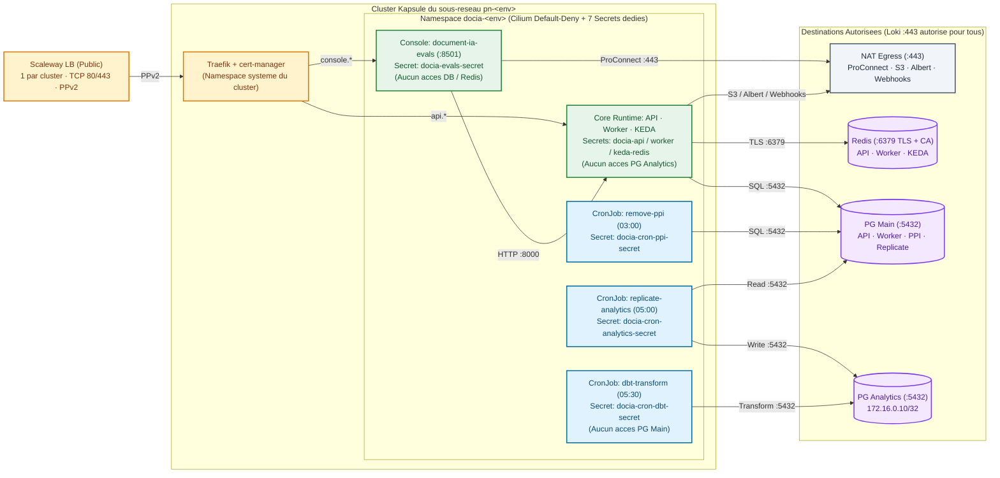
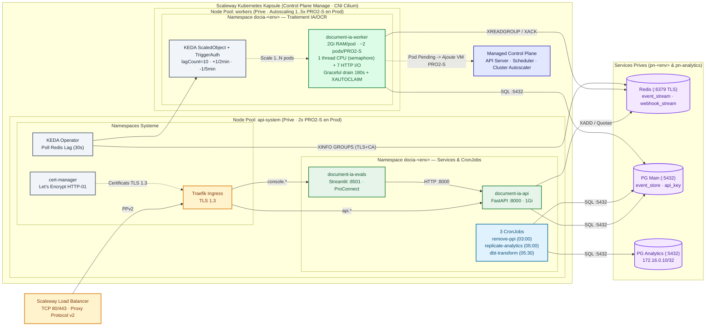

# Document IA — Architecture Cloud Scaleway (Présentation Équipe)

> **Version synthétique** destinée à la présentation équipe / CTO.  
> Pour les spécifications détaillées, les contrats Pulumi et les ADRs complets, voir [`docs/ARCHITECTURE.md`](ARCHITECTURE.md).

---

## 1. Principes Directeurs

1. **Souveraineté & Résidence (`fr-par`)** : 100 % hébergé sur **Scaleway** (projet `DocumentIA`, Organisation DINUM), sauvegardes locales `backup_same_region=True`, DNS conservé sur **OVH** (migration progressive depuis Scalingo sans risque).
2. **Zéro IP Publique sur le Compute & les Bases** : seuls les points d'entrée HTTPS (`Load Balancer` et `Metabase`) et la `Public Gateway` (NAT sortant) sont exposés. Tous les nœuds Kubernetes, PostgreSQL (`Main` et `Analytics`) et Redis sont **100 % privés**.
3. **Défense en Profondeur** : isolation L3 inter-environnements (`VPC Network ACL` en `DROP` par défaut, épinglée au `/32`), isolation intra-cluster (`Cilium NetworkPolicy`), **7 secrets Kubernetes dédiés par rôle**, et isolation S3 par `BucketPolicy`.
4. **Auto-scaling Natif sans Daemon Custom** : remplacement de `document-ia-auto-scaler` par **KEDA** (sur lag Redis Streams) + **Kapsule Cluster Autoscaler**.
5. **Conformité RGPD native** : alignement strict à **7 jours** sur S3 (lifecycle), `remove-ppi` (J+7) et les sauvegardes `pg-main` ; **30 jours** sur `pg-analytics` (données anonymisées uniquement).

---

## 2. Vue Globale — Big Picture

---

## 3. Isolation Réseau & Sécurité

### 3.1. Isolation Inter-Réseaux (Shared VPC, VPC ACL `/32` & Public Gateway)

### 3.2. Isolation Intra-Cluster (`Cilium NetworkPolicy` & Secrets par rôle)

**Points clés Sécurité** :
* **VPC ACL épinglée `/32`** : empêche Metabase (qui partage `pn-analytics`) de joindre `pn-prod` / `non-prod` en spoofing port source `5432`.
* **Bastion SSH *break-glass* en `prod`** : `bastion_enabled=False` par défaut en prod (activable ponctuellement + `bastion_allowed_ips`).
* **Moindre privilège sur les secrets** : 7 `core.v1.Secret` K8s dédiés par composant ; `document-ia-api` n'a **aucun accès** à `pg-analytics` (`auto_migrate_analytics()` est joué par le CronJob `replicate-analytics`).
* **S3 par environnement** : IAM App sans policy projet-globale + `BucketPolicy` stricte sur le bucket de l'environnement uniquement.
* **Cockpit / Loki** : datasource applicative dédiée (`observability.Source`) + token **write-only** (`write_logs=True`, zéro droit de lecture/admin) ; lecture Grafana via SSO Scaleway IAM.

---

## 4. Cluster Kubernetes Kapsule & Auto-Scaling

---

## 5. Synthèse des Décisions d'Architecture Cloud

| Domaine | Choix retenu | Justification clé |
|---|---|---|
| **Compute** | **Scaleway Kapsule** (Control Plane gratuit, CNI Cilium) | 2 Node Pools privés : `api-system` (`2x PRO2-S` en prod pour HA/upgrades sans coupure) + `workers` (`1..5x PRO2-S`, ~2 workers `2Gi`/nœud calibrés pour ~26k fichiers/j). |
| **Ingress & TLS** | **Traefik + `cert-manager`** (Let's Encrypt HTTP-01) | Remplace `ingress-nginx` (EOL 2026) ; 1 seul Load Balancer par cluster sur IP statique réservée (`Proxy Protocol v2` + `scw-loadbalancer-use-hostname=true`). |
| **DNS** | **Zone conservée sur OVH** | 7 entrées statiques (`api.*`, `console.*` en `A`, `metabase.*` en `CNAME`) pour une bascule progressive environnement par environnement depuis Scalingo. |
| **Auto-scaling** | **KEDA (`redis-streams`) + HPA `behavior`** | Parité 1:1 avec `document-ia-auto-scaler` (`lagCount=10`, `+1/2min`, `-1/5min` après 5 min de calme), `TriggerAuthentication` TLS+CA, `terminationGracePeriodSeconds: 180` + `XAUTOCLAIM`. |
| **Analytics & dbt** | **PG Analytics 100 % privé + `dbt-transform` CronJob** | Remplace dbt Cloud par `dbt-core` en CronJob K8s (05h30 UTC, juste après `replicate-analytics`) $\rightarrow$ zéro IP publique sur la base Analytics et 100 % souverain. |
| **BI (Metabase)** | **Scaleway Serverless Container (`min_scale=1`)** | Découplé des clusters K8s, attaché directement à `pn-analytics`, image pinnée `@sha256` dans le Registry Scaleway, TLS managé. |
| **Backups & RGPD** | **Snapshots natifs Scaleway (`fr-par`)** | `pg-main` prod : HA 2 nœuds + snapshots 6h–12h conservés **7 jours** (aligné `remove-ppi` & S3 7j). `pg-analytics` : **30 jours** (zéro PPI). `protect=True` en prod. |
| **Observabilité** | **Scaleway Cockpit (Loki + Grafana + AlertManager)** | Dashboards Grafana JSON et règles d'alertes versionnés en code dans une stack dédiée (`stacks/observability`), zéro impact sur le réseau lors des modifications. |

---

## 6. Points d'Arbitrage Équipe / CTO avant Déploiement

1. **Topologie des clusters (Option A vs Option B)** :
   * **Option A (3 clusters symétriques)** : `staging`, `sandbox`, `prod` 100 % isolés physiquement.
   * **Option B (2 clusters : `non-prod` + `prod`)** : `staging` et `sandbox` partagent un cluster (isolés par Namespaces + Cilium, bases/S3 dédiés) $\rightarrow$ **~30–35 % moins cher sur la non-prod**, `prod` 100 % identique et isolée.
2. **Authentification Metabase OSS & Dashboards Publics** :
   * Metabase OSS ne supporte **pas** OpenID Connect (ProConnect) nativement (licence Pro/Enterprise requise).
   * Baseline proposée : auth native email/mot de passe fort + *Public Sharing links* pour les dashboards publics (à valider avec le CTO).
3. **Passage de `document-ia-api` en Multi-Réplicas (`prod`)** :
   * Lancement avec **1 réplica API (`1Gi`)** (identique à la prod actuelle) car `AUTO_MIGRATE=true` au démarrage risque une *race condition* Alembic en multi-pods.
   * Évolution à planifier dans `document-ia` (`pg_advisory_lock` ou `initContainer` de migration) pour passer à $\ge 2$ réplicas + `PodDisruptionBudget`.
