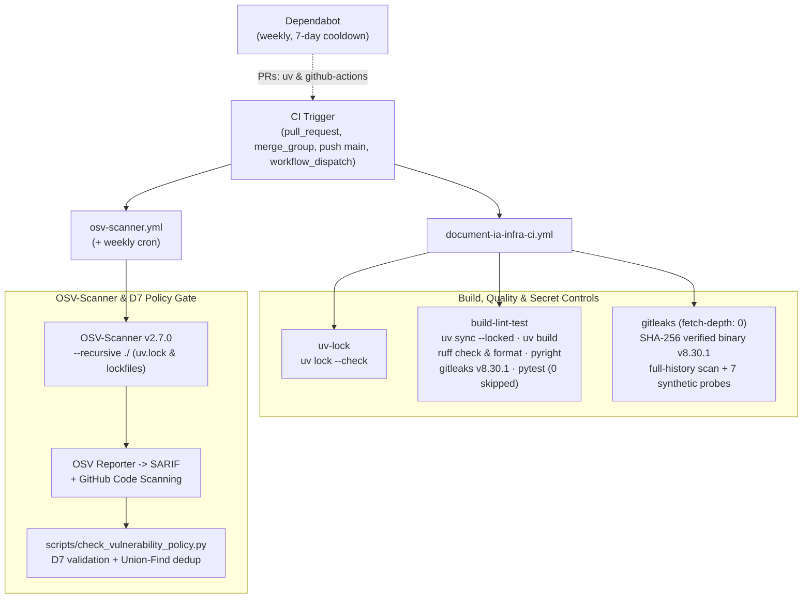
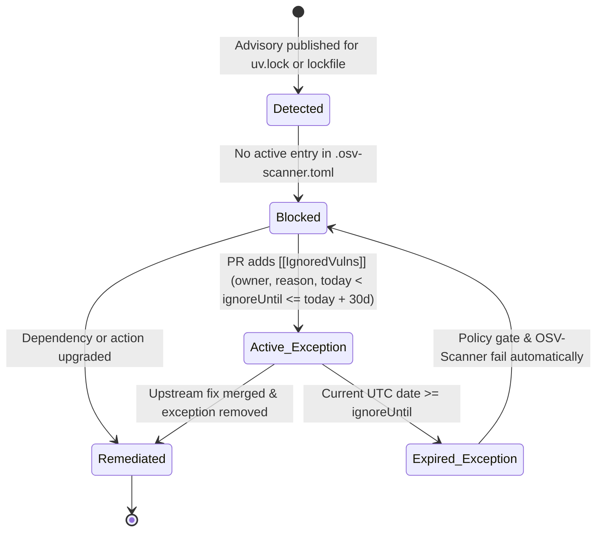

# Vulnerability, Secret Detection & CI Security Policy (Decision D7)

**Repository:** `etalab-ia/document-ia-infra` (public)  
**Architectural Decision:** `D7` (Accepted — 30-day maximum exception cap, full-inventory blocking gate across all CI events)  
**Aligned With:** `etalab-ia/document-ia` (`VULNERABILITY_MANAGEMENT_POLICY.md`)  
**Owner:** `@nicolasSagon`

---

## 1. Purpose and Scope

This document defines the enforceable dependency vulnerability, secret detection, and build quality controls for **`document-ia-infra`**. Because this repository is **publicly hosted**, defense-in-depth across local Git hooks and CI/CD pipelines is mandatory.

It implements architectural decision **D7**:

> *"A visible but non-blocking detection is not a risk decision. Any new unaccepted vulnerability and any expired exception must block delivery."*

The ratified **D7** parameters are:
- **Maximum exception horizon**: **30 days** (`DEFAULT_MAX_EXPIRATION_DAYS = 30`).
- **Enforcement mode**: **Full-inventory blocking gate** across all CI events (`pull_request`, `merge_group`, `push` on `main`, weekly `schedule`, and `workflow_dispatch`).

The CI/CD security posture covers four complementary controls:
1. **Dependency Vulnerability Control (OSV-Scanner & D7 Policy Gate)**: Recursively scans the repository (`--recursive ./`) covering [`uv.lock`](../uv.lock) and any supported lockfiles discovered in the tree, enforces temporary exception rules in [`.osv-scanner.toml`](../.osv-scanner.toml) via [`scripts/check_vulnerability_policy.py`](../scripts/check_vulnerability_policy.py), and uploads SARIF results to GitHub Code Scanning (GitHub Actions supply-chain hygiene is enforced via full 40-character commit SHA pinning and weekly Dependabot `github-actions` updates).
2. **Automated Dependency Maintenance (Dependabot)**: Weekly grouped updates for `uv` (`minor`/`patch` grouped, `major` isolated) and `github-actions`, with a mandatory **7-day cooldown** window ([`.github/dependabot.yml`](../.github/dependabot.yml)).
3. **Secret Detection & Synthetic Probe (Gitleaks)**: Scans the complete Git history against [`.gitleaks.toml`](../.gitleaks.toml) with **zero historical baseline** (strict clean history), enforces tightly scoped `[[allowlists]]` (`condition = "AND"`, `regexTarget = "secret"`) for the `.env.local.example` placeholder while still blocking real credentials in that file, adds custom `scaleway-access-key` and `document-ia-token` rules, and runs active synthetic probes on every CI run via [`scripts/verify_gitleaks_synthetic.sh`](../scripts/verify_gitleaks_synthetic.sh).
4. **Build, Lockfile & Static Quality Gates**: Verifies lockfile consistency (`uv lock --check`), strict environment sync (`uv sync --locked`), Python package build (`uv build`), Ruff linting & formatting, **blocking Pyright** static typechecking, and full Pytest execution (including Gitleaks hook & probe tests with 0 skipped tests in CI via the shared local composite action `.github/actions/install-gitleaks`) ([`.github/workflows/document-ia-infra-ci.yml`](../.github/workflows/document-ia-infra-ci.yml)).

---

## 2. End-to-End CI/CD Security Architecture

All GitHub Actions workflows enforce least privilege (`permissions: {}` at workflow scope, minimal job-level permissions, `persist-credentials: false` on checkout) and pin every third-party action to a **full 40-character commit SHA**. Local `pre-commit` hook repositories in [`.pre-commit-config.yaml`](../.pre-commit-config.yaml) are similarly pinned to full 40-character commit SHAs.



---

## 3. Dependency Vulnerability Control (OSV-Scanner & Policy D7)

### 3.1. Distinct Vulnerabilities vs. Lockfile Occurrences

A raw OSV scan output must never be conflated with the count of distinct vulnerabilities:
- A single advisory is often cross-published under multiple identifiers (`CVE-*`, `GHSA-*`, `PYSEC-*`) linked through exact `aliases` (and `groups`). By contrast, `related` and `upstream` refer to distinct advisories and are **never** merged, preventing exception bypasses.
- A single vulnerability can impact multiple package entries or lockfile/workflow locations.

[`scripts/check_vulnerability_policy.py`](../scripts/check_vulnerability_policy.py) computes three distinct metrics using a **Union-Find (connected components)** algorithm over exact linked alias identifiers:

| Metric | Definition | Role in Policy Gate |
| :--- | :--- | :--- |
| **Distinct Unaccepted Vulnerabilities** | Connected components of exact linked aliases (`CVE` / `GHSA` / `PYSEC`) not covered by an active D7 exception. Canonical ID prioritizes `CVE-*`, then `GHSA-*`, then `PYSEC-*`, then lexicographical order. | **Blocking metric** (`> 0` fails CI). |
| **Affected Package Occurrences** | Unique `(package_name, package_version, lockfile_path)` tuples impacted by at least one unaccepted vulnerability. | Operational remediation scope. |
| **Raw OSV Findings** | Unmerged count of vulnerability entries in `osv-results.json`. | Informational only (prevents count inflation). |

### 3.2. Temporary Exception Governance (`.osv-scanner.toml`)

When an upstream patch is unavailable or a vulnerability resides in an unreachable code path, a temporary exception may be proposed via Pull Request in [`.osv-scanner.toml`](../.osv-scanner.toml).

| Field | Format / Constraint | Failure Code on Violation |
| :--- | :--- | :--- |
| `id` | Official advisory ID strictly matching `^(GHSA-[a-z0-9]{4}-[a-z0-9]{4}-[a-z0-9]{4}\|CVE-\d{4}-\d{4,}\|PYSEC-\d{4}-\d+)\Z` (no leading/trailing whitespace or newline, matching OSV-Scanner Go's exact string comparison). Must be unique. | `INVALID_VULN_ID` / `DUPLICATE_VULN_ID` |
| `ignoreUntil` | Mandatory **unquoted** TOML date `YYYY-MM-DD` (`datetime.date`, neither a quoted string nor `datetime.datetime`, matching OSV-Scanner Go's TOML parser). Must satisfy `today < ignoreUntil <= today + 30 days` (aligned with OSV-Scanner Go v2.7.0 `effectiveUntil.After(time.Now())`, where a date is evaluated at `00:00:00 UTC` and is therefore expired on the day itself). | `MISSING_IGNORE_UNTIL` / `INVALID_IGNORE_UNTIL` / `EXPIRED_EXCEPTION` / `EXCESSIVE_EXPIRATION_HORIZON` |
| `reason` | Mandatory string matching `^\[Owner:\s*@([A-Za-z0-9](?:[A-Za-z0-9-]*[A-Za-z0-9])?)\]\s+(.{20,})\Z` (valid GitHub owner handle, mandatory whitespace separator, and at least 20 characters of technical justification or compensating control). | `MISSING_REASON` / `INVALID_REASON_FORMAT` / `SHORT_REASON_JUSTIFICATION` |

> [!WARNING]
> Unbounded overrides (missing `ignoreUntil`, quoted dates, expiration horizons exceeding **30 days**, `ignoreUntil <= today`, or top-level TOML keys other than `IgnoredVulns`) are automatically rejected by the CI gate.

> [!NOTE]
> **Upstream OSV-Scanner v2.7.0 deprecation (`ignoreUntil` -> `effectiveUntil`):** Starting with OSV-Scanner `v2.7.0`, the `ignoreUntil` key in `[[IgnoredVulns]]` is deprecated upstream in favor of `effectiveUntil` (still fully supported in v2.7.0 with a deprecation warning). To remain aligned with `etalab-ia/document-ia`, `check_vulnerability_policy.py` currently enforces `ignoreUntil` only; migration to `effectiveUntil` will be coordinated across both repositories ahead of a future OSV-Scanner major release.



---

## 4. Secret Detection & Synthetic Probe Verification (Gitleaks)

### 4.1. Rules & Allowlist Matrix (`.gitleaks.toml`)

[`.gitleaks.toml`](../.gitleaks.toml) inherits all built-in Gitleaks detectors (`useDefault = true`) and adds repository-specific rules and tightly scoped `[[allowlists]]` tables:

| Category | Entry | Rationale |
| :--- | :--- | :--- |
| **Custom Rule** | `scaleway-access-key` (`SCW[A-Z0-9]{17}`) | Prevents accidental commits of personal or CI Scaleway IAM access keys in IaC code. |
| **Custom Rule** | `document-ia-token` (`dia_[a-zA-Z0-9_-]{40,100}`) | Prevents accidental commits of Document IA API tokens (including Base64URL `-` characters). |
| **Scoped Allowlist (`condition = "AND"`)** | `paths = [^\.env\.local\.example$]`, `regexTarget = "secret"`, `regexes = ["^SCW" + 17 "X" + "$"]` | Allows **only** the exact dummy `SCW` + 17 `X` placeholder inside `.env.local.example` (exact regex defined in `.gitleaks.toml`). Any real `SCW_ACCESS_KEY` or real UUID `SCW_SECRET_KEY` accidentally committed into `.env.local.example` is **still blocked**. |
| **Global Allowlist Paths** | `^uv\.lock$`, `^flake\.lock$` | Lockfiles containing high-entropy SHA-256 / SRI integrity hashes. |
| **Global Allowlist Paths** | `^\.venv/.*$`, `^\.pulumi/.*$` | Local virtual environment and Pulumi plugin cache (gitignored). |
| **Global Allowlist Regexes** | `example_token_for_tests`, `YOUR_API_KEY`, `your-api-key-here` | Documentary test placeholders across source and docs. |
| **Historical Baseline** | **None** | Repository history is 100% clean from the initial commit; zero historical exceptions are allowed. |

### 4.2. Defense-in-Depth Layers

1. **Local Pre-Commit Hook** ([`.pre-commit-config.yaml`](../.pre-commit-config.yaml)): Runs SHA-pinned `ruff-check`, `ruff-format` (`v0.17.5`, matching `uv.lock`), `pre-commit-hooks`, `uv-lock`, and `gitleaks-system` (using the Nix-provided `gitleaks` binary) on staged changes.
2. **Local Pre-Push Hook** ([`scripts/pre-push`](../scripts/pre-push) & [`scripts/gitleaks_pre_push.sh`](../scripts/gitleaks_pre_push.sh)): Installs cleanly from any subdirectory (repairing broken symlinks automatically) and scans every outgoing commit range across all pushed references (covering multi-ref pushes, new branches, missing remote SHAs, and direct `pre-commit` invocations without `PRE_COMMIT_TO_REF`).
3. **CI Full-History Scan** ([`.github/workflows/document-ia-infra-ci.yml`](../.github/workflows/document-ia-infra-ci.yml)): Installs `gitleaks v8.30.1` via the shared local composite action [`.github/actions/install-gitleaks/action.yml`](../.github/actions/install-gitleaks/action.yml) with SHA-256 tarball verification and scans the complete Git history (`fetch-depth: 0`) with `--redact`.
4. **CI Synthetic Probes** ([`scripts/verify_gitleaks_synthetic.sh`](../scripts/verify_gitleaks_synthetic.sh)): Creates an ephemeral isolated Git repository (`mktemp -d`, cleaned via `trap EXIT`) and verifies **7 assertions** on every CI run:
   - **Negative control #1**: Committing `.env.local.example` with dummy Scaleway placeholders (`SCW` + 17 `X` and `00000000-...`) passes (`exit 0`).
   - **Negative control #2**: Committing an allowed placeholder (`YOUR_API_KEY`) passes (`exit 0`).
   - **Positive probe #1**: Committing a real `SCW_ACCESS_KEY` inside `.env.local.example` is blocked (`RuleID == scaleway-access-key`).
   - **Positive probe #2**: Committing a real UUID `SCW_SECRET_KEY` inside `.env.local.example` is blocked (`RuleID == generic-api-key`).
   - **Positive probe #3**: Dynamically assembled `scaleway-access-key` in a Python file is blocked (`RuleID == scaleway-access-key`).
   - **Positive probe #4**: Dynamically assembled `document-ia-token` (containing Base64URL `-` characters) is blocked (`RuleID == document-ia-token`).
   - **Positive probe #5**: Dynamically assembled high-entropy generic secret is blocked (`RuleID == generic-api-key`).

---

## 5. Local Verification & GitHub Branch Protection

### 5.1. Running Security and Quality Checks Locally

Both `gitleaks` and `pre-commit` are pre-installed in the Nix development shell ([`flake.nix`](../flake.nix)).

```bash
# 1. Install local pre-commit and pre-push security hooks (once per clone)
pre-commit install
bash scripts/pre-push

# 2. Run all static quality checks and unit tests (Ruff + Format + Pyright + Pytest)
make check

# 3. Run full-history Gitleaks scan and synthetic probes
make gitleaks

# 4. Validate .osv-scanner.toml against D7 governance rules
python3 scripts/check_vulnerability_policy.py \
  --config .osv-scanner.toml \
  --summary-output /tmp/vulnerability-summary.md
```

### 5.2. Required Status Checks for Branch Protection (`main`)

To make all security and quality controls strictly enforceable on `main`, configure the following GitHub Actions status checks as **Required Status Checks** in GitHub Branch Protection / Rulesets:

- `OSV-Scanner & Politique D7` (from [`.github/workflows/osv-scanner.yml`](../.github/workflows/osv-scanner.yml))
- `Gitleaks (historique complet)` (from [`.github/workflows/document-ia-infra-ci.yml`](../.github/workflows/document-ia-infra-ci.yml))
- `uv (verrou de dépendances)` (from [`.github/workflows/document-ia-infra-ci.yml`](../.github/workflows/document-ia-infra-ci.yml))
- `Build, Lint, Pyright & Pytest` (from [`.github/workflows/document-ia-infra-ci.yml`](../.github/workflows/document-ia-infra-ci.yml))
